# Lone Hand — Claude version

**Version 2.3.0** · [What changed (changelog)](CHANGELOG.md) · [All releases](https://github.com/iago-swi/outlaws/releases)

A first-person shooter in nine chapters, built with Claude (Anthropic) in the spirit of
late-1990s Western shooters. From a frontier town to a Japanese shrine, an alpine valley,
a Greek island, a Norwegian fjord, a village in Normandy in 1944, a Soviet city in 1974,
the Tibetan plateau in 1959 and the Aztec capital in 1520, one hero faces many enemies alone, in a real-time 3D
world you can walk through freely. Most buildings can be entered, the longships at
Jarnvik can be boarded, and every chapter has several ways to the enemy, places to climb, by a ladder or by steps of rock, and
low places to crawl through or into for an ambush. About 130 people who take no part in the fight, half of them women, go
about their work in the nine worlds: a woman keeps the bar in Dry Gulch, Penelope weaves in Ithaca, nuns turn the prayer
wheels of Che La. Twenty-seven heroes from history and legend are playable, three per
chapter. Online, two to four players fight each other, one against one or two against two,
as a hero or as one of thirty villains, or play a chapter together against its enemies.

The whole game is one file, `index.html`. Every texture, model, sound and piece of music
is generated in the browser when the game starts; there are no image, model or audio
files.

**[Play it in your browser](https://outlaws.kaiseregg.com/)**

| Chapter I · Dry Gulch | Chapter II · Kagemori | Chapter III · Uri |
| :---: | :---: | :---: |
| 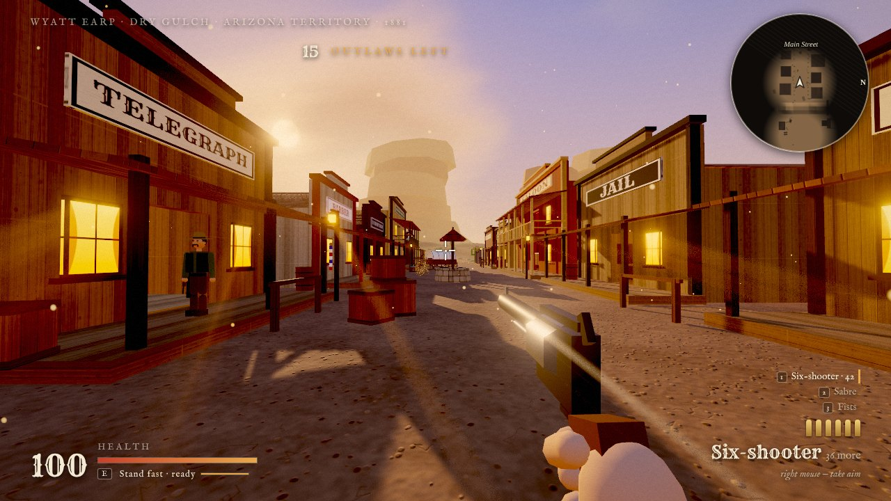 | 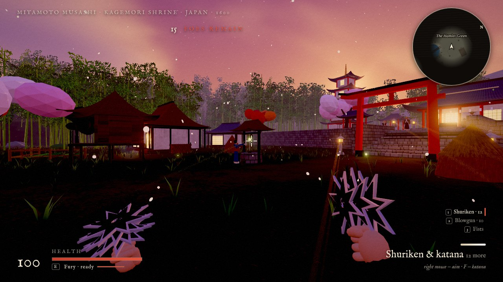 | 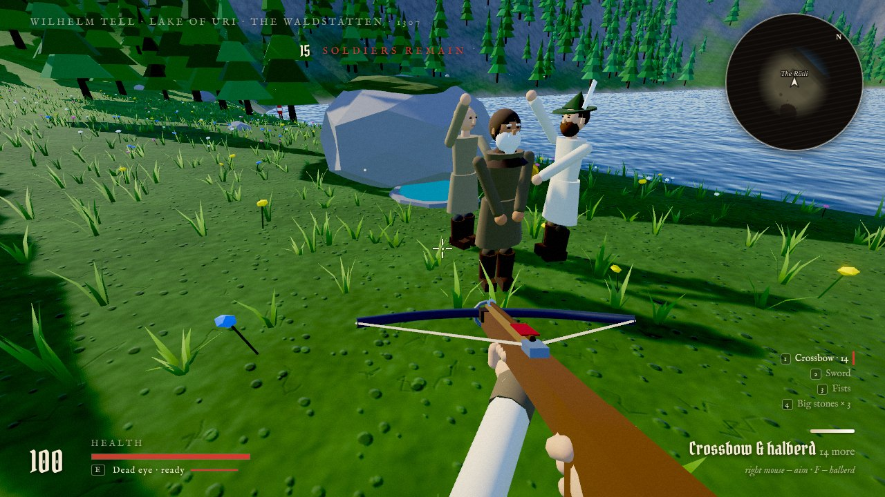 |
| **Chapter IV · Ithaca** | **Chapter V · Jarnvik** | **Chapter VI · Sainte-Aubine** |
| 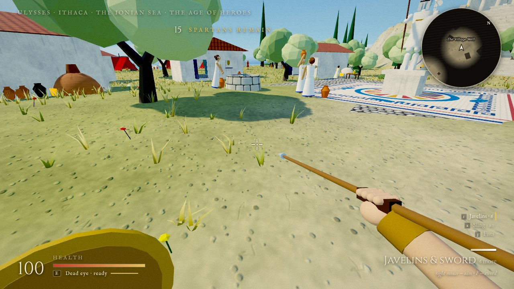 | 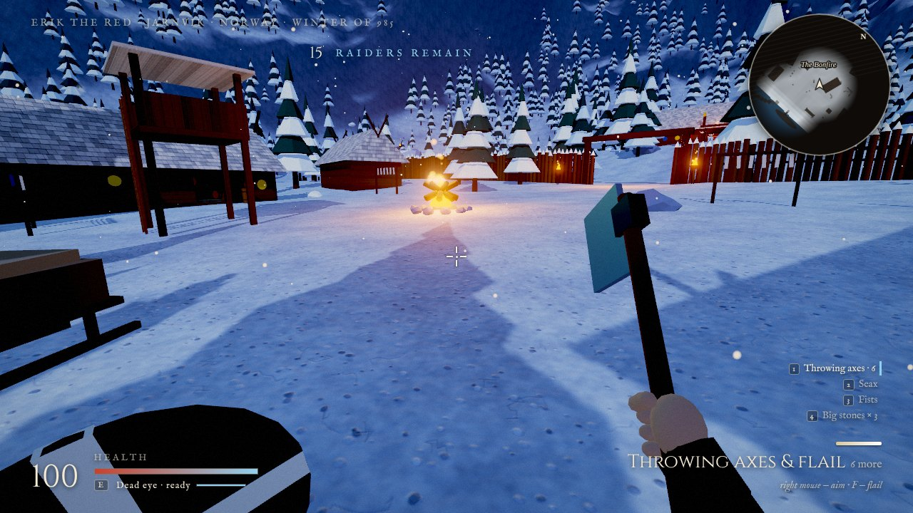 | 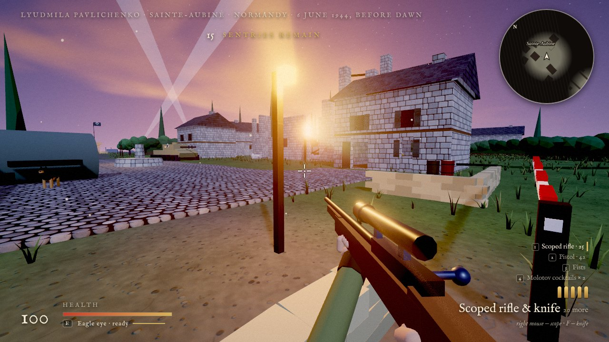 |
| **Chapter VII · Stalnogorsk** | **Chapter VIII · Che La** | **Chapter IX · Tenochtitlan** |
| 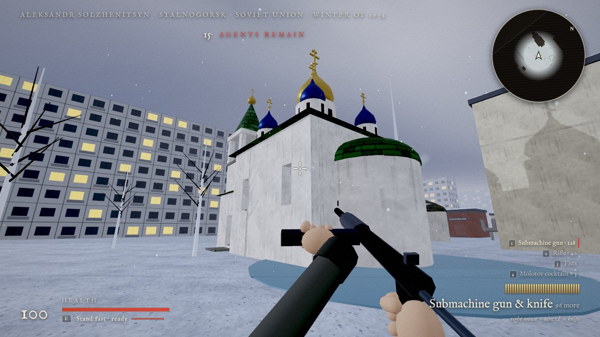 | 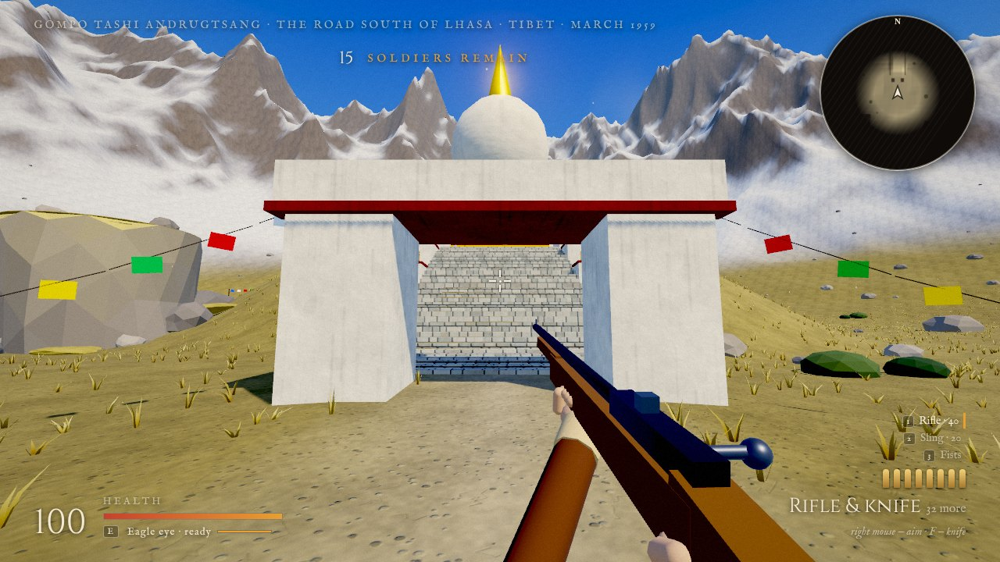 | 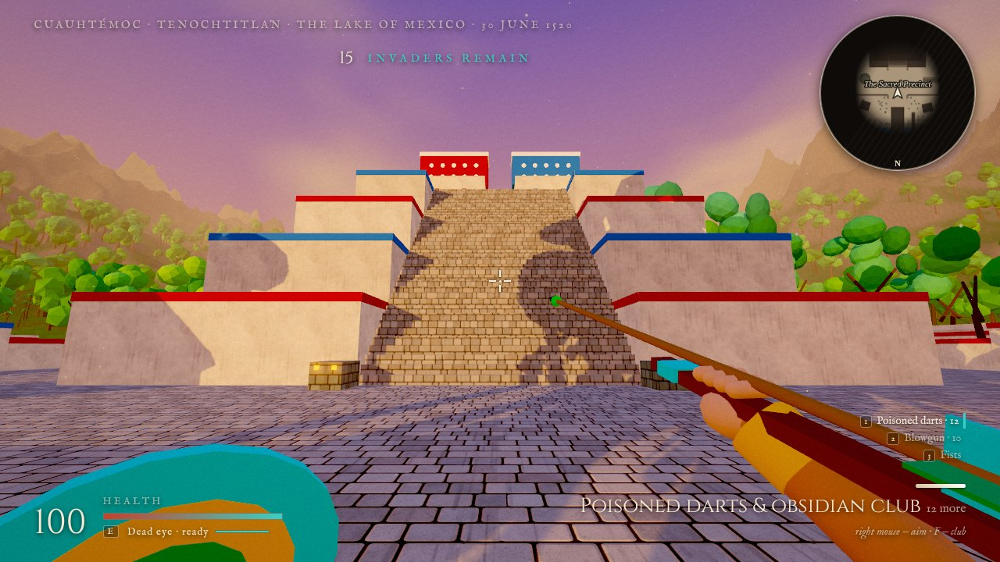 |

| Duel · choose your fighter | Duel · face to face |
| :---: | :---: |
| 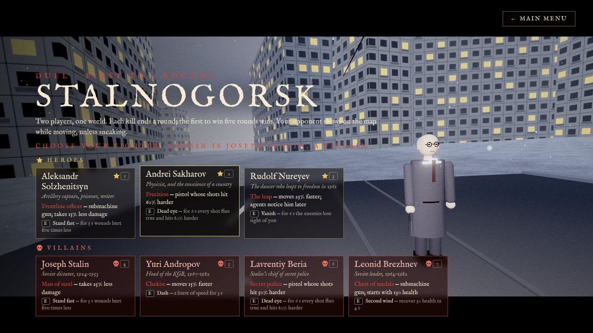 | 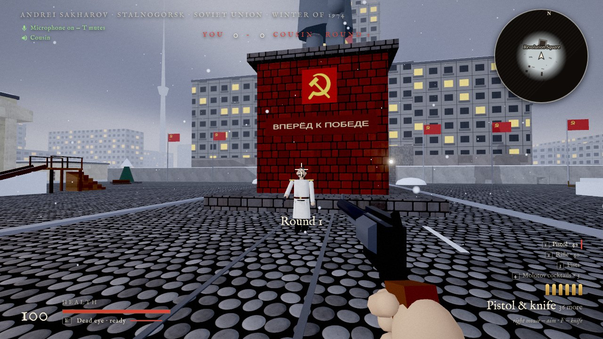 |
| **Online · four players in the lobby** | **Online · two against two** |
| 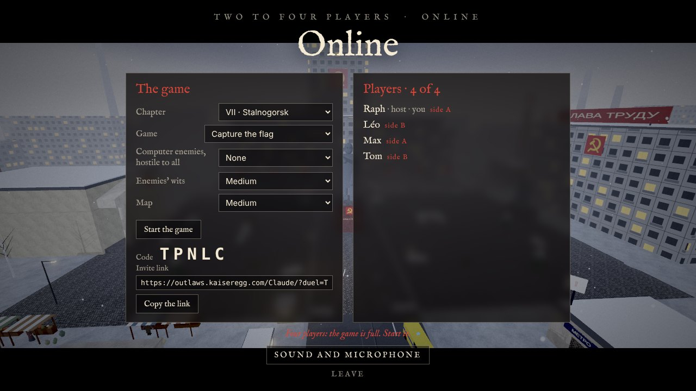 | 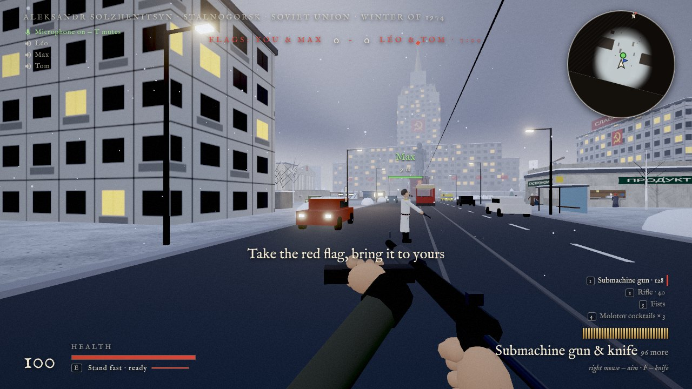 |

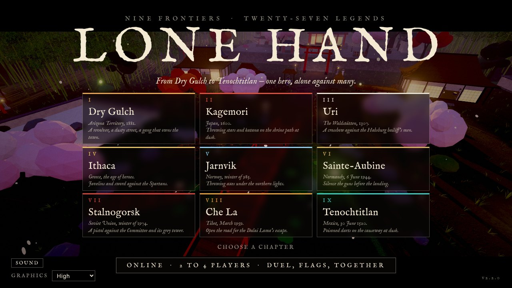

## Run it

Play online with the link above. To play offline, download the folder and open
`index.html` in a current version of Chrome or Edge, or double-click `Play.bat` on
Windows. No installation, build step, web server or internet
connection is needed, except for games online. A mouse and keyboard are required; there are
no touch controls.

The title screen shows a different chapter behind it on every visit, and takes that
chapter's accent colour and lettering.

## How to play

Clear every enemy to finish a chapter. The map in the top-right corner shows the enemies
who are on the move; the last three come looking for you. Health items
(tonic, rice cake, alp cheese, ambrosia, mead, calvados, hot tea, butter tea, cacao) go
into the bag and restore 35 points when used (`H`, or take one in hand and press the left
button).

| Chapter | Weapons (the second one of the chapter, and the bag at the start, in brackets) | Enemies (at most 30, 45 on a large map, see *Choose your hero*) |
| --- | --- | --- |
| I · Dry Gulch, Arizona Territory, 1881 | six-shooter (cavalry sabre) | cowboys, sombrero bandits, the gang boss Silas Crowe |
| II · Kagemori, Japan, 1600 | throwing stars (shuriken) and katana (blowgun) | ninja who ambush from smoke, rōnin, archers, the Iron Rōnin |
| III · Uri, the Waldstätten, 1307 | crossbow and halberd (sword; three big stones) | Habsburg halberdiers, crossbowmen, knights, the bailiff |
| IV · Ithaca, Greece, the age of heroes | javelins and short sword (sling) | Spartan hoplites, javelin throwers, their captain |
| V · Jarnvik, Norway, winter of 985 | throwing axes and a flail (seax; three big stones) | rival Vikings in animal skins, berserkers, bowmen, chieftains in horned helmets, the grey jarl |
| VI · Sainte-Aubine, Normandy, 6 June 1944 | scoped rifle, Sten gun or pistol, and a knife (a pistol, or a rifle for the hero with a pistol; two Molotov cocktails) | German riflemen, officers, machine-gunners, guard dogs, the battery commander |
| VII · Stalnogorsk, Soviet Union, winter of 1974 | submachine gun or pistol, and a knife (a rifle; three Molotov cocktails) | KGB agents, militia with submachine guns, guard dogs, Colonel Voronin |
| VIII · Che La, Tibet, March 1959 | rifle or pistol and a knife, or bow and sword (herder's sling) | Chinese riflemen, machine-gunners, Red Guards, Commander Zhao |
| IX · Tenochtitlan, Mexico, 30 June 1520 | poisoned dart-thrower, stones or bow, and an obsidian-edged club (blowgun) | Spanish swordsmen, crossbowmen, arquebusiers, horsemen, a cannon and its gunner, Captain Luján of the rear guard |

### Places you can go into, onto and behind

Walls, furniture, iron bars and living bodies are solid for the player and for enemies,
and some enemies wait indoors, on deck or behind the waterfall.

| Chapter | Open buildings and other places |
| --- | --- |
| I | saloon with its upper floor and balcony, the Grand Hotel with lobby, stairs, bedrooms and balcony, barber's, doctor's, jail with two barred cells, bank with its safe, general store, sheriff's office with a cell, livery stable, blacksmith's forge, undertaker's, telegraph office, most with a back door onto the lots behind the street; the church, with its nave, a choir gallery and a stair inside the tower up to the bell; a barn with a hayloft, a homestead, the crypt on Boot Hill; the railroad station, a boxcar to walk through, the stage station, the Silver Queen mine |
| II | every house, each furnished differently (walk-through, with open screens), the shrine hall with a back door and an inner sanctuary behind it, the dojo in its walled compound, a hermitage; two storeys of the pagoda, a storehouse, the bell tower; a granary on stilts, a cow shed, a barn by the rice paddies; the arched bridge over the pond, a jetty with a boat |
| III | the chalets, two of them with an upper room reached by an outside stair, the chapel, a Habsburg watchtower with a fighting gallery; the keep under construction (a masons' store below, a scaffold to the top), the bailiff's pavilion and a soldiers' tent; the barns on their stone stilts and a drive-through hay barn with a loft; a mill with a turning wheel, the Sust (goods store) at the lake landing and a lake boat to board; the ledge behind the waterfall |
| IV | every house, each with its trade (potter, smith, baker, weaver, fishermen), the temple's inner room with a golden Athena, a treasury on the hill, the round temple, the beacon tower on the fishermen's cape up to its fire platform; a villa with a colonnaded court and a pool, the market under the colonnade, the theatre with its stage house, the olive grove with its press; two tents in the harbour, the Cave of the Nymphs, a swineherd's farm |
| V | every longhouse, each with its trade (weaver, cook, mead store, fisherman), two of them with a second door and window openings, the jarl's great hall with a back door, a small temple of the old gods; a boat shed, an open smithy, a byre with a hay loft, a shipyard with a hull on the stocks; four longships to board by gangplank: two at the jetty, your own on the beach and the jarl's great ship with a tent on deck |
| VI | the ground floor of every house (a café, a bakery, a school and a forge among them) and the upper room of the café, the command bunker, both gun casemates, the manor, the windmill with its milling floor; the church, now a roofless ruin after the bombing, and its tower up to the belfry; a farm barn with a hayloft, a cider farm, a railway station |
| VII | the food shop with its store room, two garages, the Palace of Culture with its stage, the works with a gallery, and the Committee building: lobby, cells, archive, records room and the colonel's office; a block of flats with a stairwell to walk through and a furnished flat, a tram, a goods wagon, a boiler house, a church closed and used as a store; the metro pavilion with its turnstiles and the escalator hall down to Revolution Square Station, 10 m below ground (a platform between two tracks, marble columns, chandeliers, a train standing with its doors open); Entrance 2 of the long block on the courtyard, a stairwell up five floors with a furnished flat on every landing (hall, kitchen, living room); the church of St Nicholas, still open (refectory, bell tower, the screen of icons); the district library, a building site with a concrete slab to climb and the builders' hut |
| VIII | the village houses, each furnished differently, the old fort, the monks' houses and the monastery's assembly hall with its gallery, side doors and kitchen; the village temple, the chapel of the great prayer wheel, a nomad tent of black yak hair; two army tents, the bed of a lorry, a field barn with a hay loft |
| IX | the two shrines on top of the Great Temple, each with an altar heaped with gold; the palace of Axayacatl with its rooms round a patio, the market, the temple of the wind god, the House of the Eagles, the ball court; the white houses of the city and of the landing village; a steam bath |

| Below Stalnogorsk · the metro | Inside the church of St Nicholas |
| :---: | :---: |
| 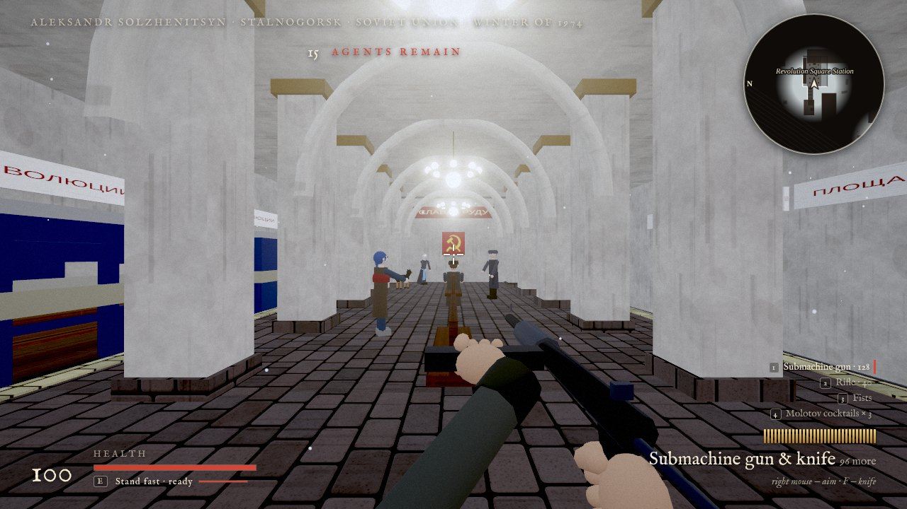 | 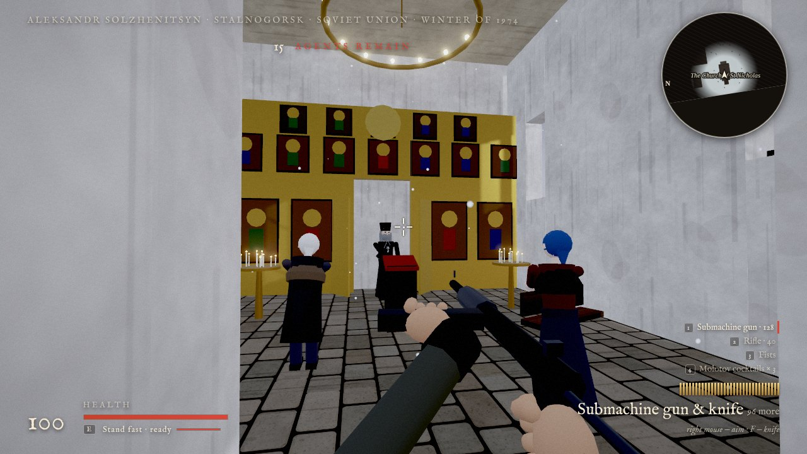 |

Things to find on the way: mosaic floors and a bronze Athena in Ithaca; the hammer and
sickle on the flags, the monument, the palace and the tower of Stalnogorsk; a gilded
Buddha in each of the three temples of Che La; bomb craters in Sainte-Aubine.

### People who take no part in the fight

Every chapter has ten to eighteen bystanders (more on a large map, and more in chapter VII),
about half of them women, dressed for the place and the time and busy with something. They
breathe, shift their weight and look about; those at work keep working (hammering,
scrubbing, churning), those talking talk with their hands, those seated take a drink now and
then, those at prayer bow, and some of those standing about go for a stroll and come back;
nobody stands still like a statue. Those on the boats of chapter IX and of the outskirts
paddle or pole and stay aboard. They greet you when you stand by them, and chatter among
themselves. About one in four, hurt by you and still standing, fights back: he draws the
weapon of the chapter's commonest enemy and becomes one of them, as strong as they are and
no more, with his own looks (not in a game online).

### Animals

| Chapter | Animals |
| --- | --- |
| I | horses in the corral, at the livery and at the hitching rail, a mule, hens |
| II | an ox in its shed |
| III | cows on the pasture, two pack mules at the Sust |
| IV | goats, pigs, and the old dog Argos lying by the villa's door |
| V | ponies, sheep |
| VIII | yaks, horses |
| Large maps | a horse tied up by some of the hamlets |

The animals breathe, shift and lower their heads to graze. A shot or a blast near them sends
them running a little way. They can be hurt and killed, and fall on their side. Some of
them, hurt and still standing, turn on you: about half the horses, oxen and yaks, a third of
the cows, mules and goats, a quarter of the pigs, the dog almost always; sheep and hens never.
One that turns charges and strikes like an enemy fighting hand to hand, as strong as the
chapter's enemies and no more (a horse: 90 health, a kick of 20), and counts among the foes
that remain.

| Chapter | Who is there |
| --- | --- |
| I | the woman who keeps the bar, the pianist, the storekeeper, the telegraph operator, the hotel keeper, the barber, the doctor, the undertaker, the preacher, a deputy locked in his own cell, a woman hanging out washing, a homesteader's wife, a gravedigger |
| II | three flute monks (komusō) under basket hats and four geisha under oil-paper umbrellas; a woman at the well, two planters in the rice paddies, an old man on the tea-house veranda, an angler, a woodcutter, a pilgrim, a weaver |
| III | three confederates by the flags at the start; the Senn and the dairywoman, a woman spinning with distaff and spindle, the miller's wife, a priest, a boatman, a woman mending nets, masons; on the Rütli meadow three men raise their hands for the oath |
| IV | three women at the well, Penelope at her upright loom, the swineherd Eumaeus, the old dog Argos by the villa's door, a baker at her oven, a market woman, a priestess, a potter, an old fisherman, a bard with a lyre, a shepherd with goats |
| V | Norse women at the loom, the cauldron, the mead casks and the cod racks, one in a doorway looking out to sea; a skald, a priest of the old gods, a boat builder, a shepherd, two of your crew aboard your ship; two captives at a post in the raiders' yard |
| VI | the baker and his wife, a woman at the café window, the schoolmistress, an old woman in the churchyard, a farm woman, the curé, a farmer, a railwayman, a man of the Resistance, a wounded glider pilot by the wreck |
| VII | a saleswoman and the people waiting outside the food shop, two men at chess, a yard-keeper, a librarian, two stallholders, an ice fisherman, a lathe worker, two prisoners in the Committee's cells; passengers and a cleaner in the metro; people at home in the flats; an Orthodox priest and old women at prayer in the church of St Nicholas |
| VIII | the Dalai Lama with two monks and three Khampa riders at the start; nuns at the prayer wheels, women in striped aprons at the loom, the tea churn and on the terraces, two Nepalese traders with their bales, a Khampa herder with his yaks, an old hermit in his cell |
| IX | a drummer at the great drum on the Great Temple, market women, a woman at the grinding stone, a weaver, an old man in a doorway, a conch-blower on the palace roof, men and women in canoes on the lake |

### Climb, jump and hide

Press `C` to crouch. A crouching player moves at half speed, is noticed
from 40% less far, is hidden by anything about a metre high, and fits through low doors.
Ladders need no key: face one and walk into it, and you climb; at the top you step onto
the roof or the deck. A jump clears about 1.3 m.

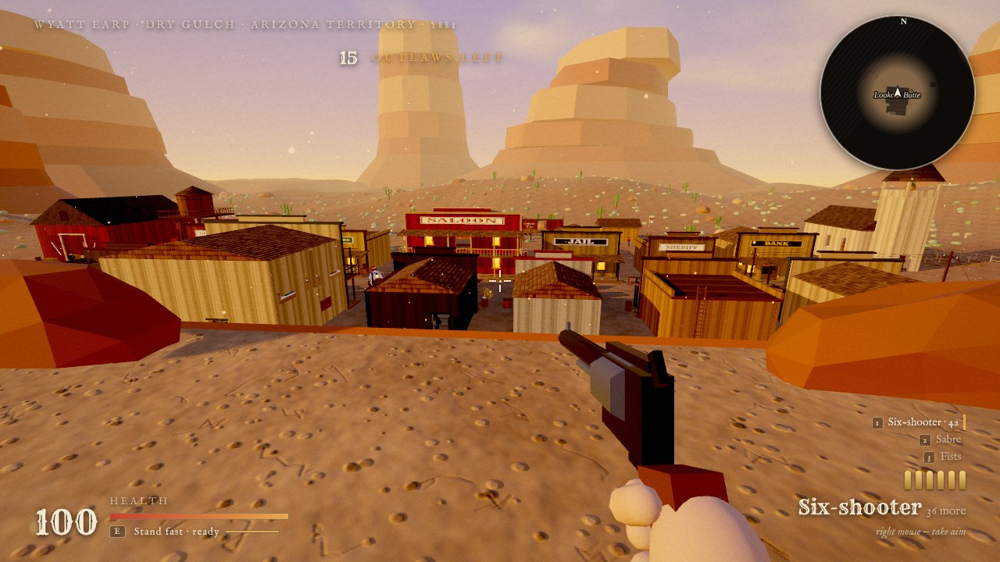

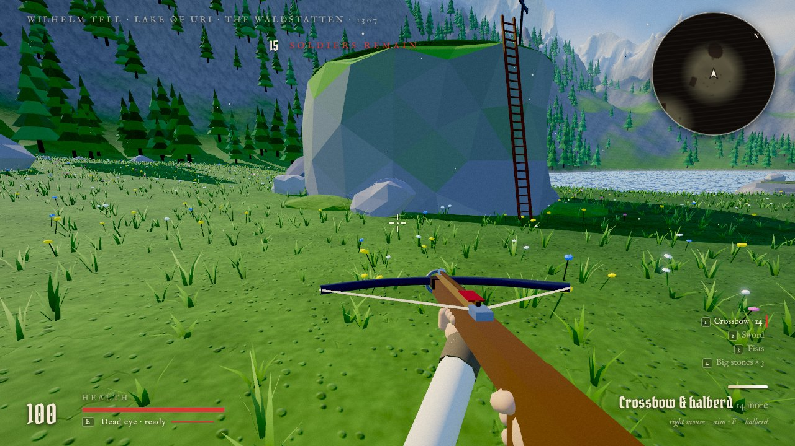

| Chapter | Places for an ambush, a sniper or a way round |
| --- | --- |
| I | Lookout Butte south of town, 12 m high, climbed by a zigzag of rock steps, with boulders on top to crouch behind; the flat roofs of the general store, the sheriff's office, the blacksmith and the telegraph office, each reached by a ladder at the back; the catwalk of the water tower, the windmill's platform, the barn's hayloft and the roof of the boxcar, all by ladder; the church tower up to the belfry, 11 m up; the back lots behind both rows of the street, with woodpiles and privies; a dry wash that runs unseen from the street to Boot Hill; a root cellar with a crawl-in door; the loading dock, the boxcar, a hay cart and the stage coach to crawl under; a low drift in the mine |
| II | a watch platform in the dojo court and a low water gate into it; a side stair and a ladder onto the shrine terrace; the upper room of the pagoda with window slits; a mossy boulder with a ladder above the gate path; the granary on stilts, with a crawl space below and a loft above; a path round the ambush over the dikes of the rice paddies; a tea hut and a charcoal kiln to crawl into |
| III | a great boulder in the meadow west of the path, 7.5 m high, with a flat grassy top and a summit cross of dark iron, reached by a wooden ladder that leans against its flank; a hunter's high seat near the start; the scaffold of the keep, three ladders to the top; the watchtower's gallery; a sunken lane to the keep; a gap under the camp's palisade; a hay wagon and the mill's water channel to crouch under; the stepped blocks of the quarry |
| IV | a goat path up the back of the temple hill; the roofs of the colonnade and of the stage house, and the fire platform of the beacon tower, by ladder; a flat roof with an outside stair; a crag above the harbour; a lookout above the landing beach; an old cistern that is now a crawl tunnel with two ends; the back door of the cave; a hull on the stocks and a boat on trestles to crawl under; a sandbar to an islet with a shrine |
| V | a fighting step behind the palisade on both sides of the gate, with stairs; a hole under the palisade; a beacon crag with a ladder; the byre's loft; a watch platform in the village; an earth cellar; a tunnel of cod racks, an upturned boat and the keel of the ship being built to crawl under; firewood stacks behind the houses; ice floes from the beach to the jetty; the decks of the longships |
| VI | fourteen holes to crawl through the hedgerows, and a sunken lane between two of them; a trench through a gap in the wire to a lookout on the cliff; the belfry of the church tower, by two ladders; the roof of a gun casemate under a camouflage net; the barn's hayloft; three hollow hayricks; two railway wagons to crawl under; a hunter's stand among the hedgerows; a dugout; the churchyard with its gravestones |
| VII | three ways into the Committee building beside the front steps: a side door, a service door and a drain under the wall; the roofs of the garages, the food shop and the works, by ladder; the gallery in the works; the top slab of the building site and a perch on its crane; an ice slide, a snow fort and snowbanks on the square; a boxcar and the heating pipes to duck under; a cellar hatch |
| VIII | a gully from the frozen lake to the foot of the monastery hill, with a log bridge over it; the flat roofs of three houses and of the fort, by ladder; a boulder with a ladder beside the monastery court; a breach in the fort's wall to crawl through; two lorries to crawl under; dry-stone walls on the barley terraces; a lookout beside the road; a hermit's cell |
| IX | the top of the Great Temple, 17 m up, reached by its stair, with two shrines for cover; two ways to the shore beside the causeway: over the garden plots on planks, and along an aqueduct; a row of four house roofs to cross on planks; the roof of the palace; a drain through the precinct wall; raised market floors and upturned canoes to crawl under; a reed watchtower and a reed lookout with ladders; a rock with a ladder at the landing; a steam bath to crawl into |

Every watch platform, lookout, high seat and hunter's stand has a ladder too.
Enemies can follow you up anything that has steps and stands in the open: the butte can be
stormed. Both the butte and the boulder are held by a marksman when you arrive. Enemies of
*Medium* and *Genius* wits (see *Choose your hero*) climb ladders after you and crouch into
low hiding places; dull ones (*Low*) do neither, so for them roofs, platforms and high seats
are safe from blades, though not from bullets. Upper floors are an exception among the stairs: the
route grid knows one floor per spot, so where a stair leads to a room or a roof above
another room (the saloon and the hotel in chapter I, the church towers, the house roofs of
chapters IV and IX) enemies stay below, and whoever is posted up there holds the post.

### Choose your hero

Each chapter starts with a choice of three heroes from history and legend. Point at a
card to see the figure in the opening shot, then click it, or press `1` to `3` and
`Enter`. Every hero has their own look and one strength; in chapters VI to VIII the heroes
also carry different weapons.

Above the cards, the **Enemies** list sets how many enemies the chapter holds: 5, 10, 15,
20, 25 or 30 (up to 45 on a large map). It starts at 15. The boss always
stays and every kind of enemy is kept as long as the number allows; the others are taken
away where they stand thickest, so the whole map remains guarded. The choice is kept for
the next chapter and when you retry.

Beside it, two more lists, also remembered:

- **Wits**: how the enemies think. *Low*: they fight back when they see you or are hurt,
  but hear nothing, never climb or crawl after you, stay near their post and give up as
  soon as you are out of sight for a moment. *Medium* (the default): those with a gun or a
  bow take up places with a view and something to hide behind; they hear what goes on
  near them, go after you where they last saw or heard you (up ladders, crouching into
  hiding places), search for about twelve seconds and walk back if they find nothing or you
  got far away. *Genius*: they hear from almost twice as far and see a little further,
  tell each other where you are (within 60 m), fight from cover, crouched and rising to
  shoot, move to a new place after a few shots or hits, come round the sides, creep up
  crouched where you cannot see them, throw their bombs at where you hide, keep their
  distance when badly hurt, and half of their marksmen start on a roof, a deck or a
  balcony. They also shoot straighter and react faster.
- **Map**: *Small* keeps only the heart of the chapter, from where you come in to where the
  boss stands, with a rope and little red and white flags along the edge; enemies who stood
  outside are not there. *Medium* is the chapter as it was made. *Large* makes it half as
  wide again, with outskirts in the chapter's own style: up to nine hamlets of two or three
  houses you can walk into, each furnished (table and bench, a bed or a chest, jars), with
  things in the yard, a fence, trees, two to four people at work, a horse in some chapters
  and smoke from the chimneys; the ground of a hamlet on a hillside is levelled for it, and
  where the new ground is water there are boats at anchor with their crews. Two or three
  enemies are about each hamlet.

**Two weapons and a skill.** Every hero sets out with his own weapon and the second weapon
of the chapter (see the table below), and presses `E` for his **special skill**, shown
under the health bar (ready, at work, or how many seconds until it is back) and on his
card:

| Skill | What it does | Lasts | Back after |
| --- | --- | --- | --- |
| Dash | a burst of speed, 80% faster | 3 s | 16 s |
| Stand fast | wounds hurt five times less | 5 s | 28 s |
| Dead eye | every shot flies true and hits 80% harder | 6 s | 28 s |
| Second wind | 50 health back over four seconds | 4 s | 36 s |
| Vanish | the enemies lose sight of you and go where they saw you last; in a duel the other player sees only a faint shape | 6 s | 32 s |
| Fury | blows strike twice as hard and 60% quicker, and you move 20% faster | 7 s | 26 s |
| Eagle eye | every enemy within 90 m is marked through walls and shows on the map | 9 s | 30 s |


| Chapter | Hero | Who | Strength | Skill (`E`) |
| --- | --- | --- | --- | --- |
| I | Wyatt Earp | Lawman of Tombstone, 1881 | Iron nerve: takes 25% less damage | Stand fast |
| I | Calamity Jane | Scout and sharpshooter of Deadwood | Frontier scout: moves 18% faster | Dash |
| I | Billy the Kid | The fastest gun in New Mexico | Quick draw: fires and reloads much faster | Dead eye |
| II | Miyamoto Musashi | Undefeated duellist, master of two swords | Two swords: faster katana cuts with longer reach | Fury |
| II | Tomoe Gozen | Woman warrior of the Genpei War | Swift hands: throws her stars almost twice as fast | Dead eye |
| II | Date Masamune | The One-Eyed Dragon of Sendai | Black armour: takes 30% less damage | Stand fast |
| III | Wilhelm Tell | The crossbowman of Bürglen, Uri | Master shot: reloads the crossbow 40% faster | Dead eye |
| III | Arnold von Winkelried | Hero of Sempach, from Nidwalden | Breaks the line: starts with 150 health | Second wind |
| III | Werner Stauffacher | Man of Schwyz, of the Rütli oath | Steadfast: slowly recovers health out of danger | Second wind |
| IV | Ulysses | King of Ithaca, the man of many wiles | Sure aim: javelins fly faster and hit harder | Dead eye |
| IV | Achilles | Greatest warrior of the Trojan War | Nearly invulnerable: takes 35% less damage | Stand fast |
| IV | Heracles | Strongest of heroes, of the twelve labours | Strength of ten: starts with 170 health | Second wind |
| V | Erik the Red | Outlaw and founder of Greenland | Hot temper: throws axes much faster | Dead eye |
| V | Leif Erikson | Leif the Lucky, who sailed to Vinland | The Lucky: takes 30% less damage | Stand fast |
| V | Ragnar Lothbrok | Legendary sea-king and raider | Raider: faster, harder blows with the flail | Fury |
| VI | Lyudmila Pavlichenko | Soviet sniper, 309 confirmed kills | Sniper: scoped rifle, one shot fells a soldier | Eagle eye |
| VI | Virginia Hall | American spy, “the limping lady” | Spy: Sten gun; sentries notice her much later | Vanish |
| VI | Maurice Bavaud | Of Neuchâtel, who set out to shoot Hitler in 1938 | Sure hand: pistol whose shots hit 60% harder | Dead eye |
| VII | Aleksandr Solzhenitsyn | Artillery captain, prisoner, writer | Frontline officer: submachine gun; takes 15% less damage | Stand fast |
| VII | Andrei Sakharov | Physicist, and the conscience of a country | Precision: pistol whose shots hit 60% harder | Dead eye |
| VII | Rudolf Nureyev | The dancer who leapt to freedom in 1961 | The leap: moves 25% faster; agents notice him later | Vanish |
| VIII | Gompo Tashi Andrugtsang | Khampa leader of the Chushi Gangdruk | Marksman: rifle, one shot fells a soldier | Eagle eye |
| VIII | Ani Pachen | The warrior nun who led her clan on horseback | Rider: pistol; moves 20% faster | Dash |
| VIII | Songtsen Gampo | The king who founded the Tibetan empire | King of old: bow and sword; takes 20% less damage | Stand fast |
| IX | Cuauhtémoc | The Descending Eagle, last ruler of the Mexica | Descending Eagle: poisoned darts that fly faster and hit harder | Dead eye |
| IX | Tzilacatzin | Warrior of Tlatelolco, who felled Spaniards with stones | Stone thrower: hurls heavy stones; starts with 130 health | Second wind |
| IX | Nezahualcóyotl | The Fasting Coyote, poet-king of Texcoco | Fasting Coyote: bow and club; moves 15% faster | Dash |

The heroes are drawn from history, myth and saga, not from any film, series or comic.
Several do not belong to their chapter's year or place (Winkelried is of 1386, Tomoe
Gozen of the twelfth century, Ragnar of the ninth; in 1944 Pavlichenko was on the
Eastern Front and Bavaud had been executed three years earlier); they appear as legends
beside the others.

Chapter VI is set in occupied France. Its three heroes are real people who resisted the
Nazi regime, and they are shown with respect. The chapter shows no Nazi symbols: vehicles
and the flag carry a plain bar cross.

Chapter VII is set in Stalnogorsk, an invented Soviet city. Its three heroes are real
people who stood against the Soviet state, and none of them ever fought it with a gun:
Solzhenitsyn was expelled from the country in 1974, Sakharov was banished to Gorky in
1980, and Nureyev had left in 1961. The mission, to bring a seized manuscript out of the
Committee's tower, is fiction. The hammer and sickle hangs on the flags and public
buildings, as it did in any Soviet city of that year.

Chapter VIII follows a real event: the Dalai Lama's escape from Lhasa in March 1959. He
stands with his caravan where the chapter starts, unarmed, and is never part of the
fighting; the player clears the road ahead of him. Gompo Tashi Andrugtsang and Ani Pachen
did fight in those years; Songtsen Gampo is a king of the seventh century. The Red Guards
belong to the years after 1966 and are in the chapter by request, not by the calendar.

### Online: two to four players — duel, capture the flag, together

Click **Online** on the title screen. Two to four players, each on their own computer,
play one of the nine chapters against each other, or together against its enemies.

1. Each player writes a name at the top of the screen (it is remembered): the others see
   it in the scores, in the messages and, on your side, over your head. One player, the
   host, clicks *Create and get the invite link*.
2. The host sends the link, or its code of five characters, to the others, who open the
   link or type the code. Up to three can join. The *Players* list shows who is in, and
   on which side.
3. Meanwhile the host chooses the chapter, the game, how many computer enemies are in the
   world (none, or 3 to 24 by threes; at least 3 together), their wits and the size of the
   map; the others see the choice. When everyone is in, the host clicks *Start the game*.
4. Everyone chooses a fighter. The game starts when all have chosen.
5. After a game everyone stays connected. A click on the end screen leads back to the
   Online screen, where the host picks the next chapter and rules and starts again; others
   may join between two games. No new link or code is needed until the host leaves.

**Sides.** In the duels and in capture the flag the players form two sides: in the order
they joined, the host first, they take turns, so the first and the third play against the
second and the fourth. With two players it is one against one; with three, two against one.
Nothing fired or thrown on your side can hurt your team-mate.

| Game | How it is played, and how it ends |
| --- | --- |
| Duel · first to 5 rounds | A round ends when everyone on one side has fallen; a player who falls waits for the end of the round. Everyone starts the next round with full health, the two sides at opposite ends of the map, and the sides change ends every round. The first side to win five rounds wins. |
| Duel · 7 minutes, most kills | Each fall scores a point for the other side. A player comes back three seconds after falling, at the end of the map farther from the other side. After seven minutes, the side with more points wins. |
| Capture the flag | Each side's flag stands at its end of the map: blue is your side's, red the other's, on the maps too. Walk into the red flag to take it, and into yours, at home, to score a capture. A carrier who falls drops the flag where he fell; walk into your own lying out there to send it home (it goes home by itself after 25 seconds). A carrier shows on the other side's maps even when sneaking. First side to three captures, or the most after seven minutes. A fallen player comes back at his end after four seconds. |
| Together against the enemy | All the players start side by side against 3 to 24 of the chapter's enemies, the boss among them. Nothing one fires or swings can hurt another. Each counts his own kills (the host's browser decides who struck the last blow). A fallen player is back at the start five seconds later. The mission is over when the last enemy falls. |

In every game the enemies stand at places drawn at random for that game, the same in every
browser (the host's browser draws a number that all use); the outskirts of a large map
and the posts the enemies take up are the same everywhere too. Each team-mate's name,
distance and health show over his head, through walls, and at the edge of the screen when
he is out of view; the ground a team-mate passes near is uncovered on your map, a place
you mark with the middle button shows on his screen, and what one of you puts down with
`G`, another can take. The end screen gives each side's score and, with more than two
players, each player's kills.

In a duel each chapter offers its villains beside its three heroes. Heroes stand in a
row marked with a gold star, villains in a row marked with a red skull, and every card
carries the same mark. Like a hero, a villain has their own look and one strength.

| Chapter | Villain | Who | Strength |
| --- | --- | --- | --- |
| I | Jesse James | Bank and train robber of Missouri | Train robber: moves 15% faster |
| I | Ike Clanton | Rustler of Tombstone, Earp's enemy at the O.K. Corral | Rustler: starts with 130 health |
| I | Belle Starr | The Bandit Queen of Indian Territory | Two guns: fires 30% faster |
| II | Oda Nobunaga | Warlord, the Demon King of the Sixth Heaven | Warlord: takes 25% less damage |
| II | Sasaki Kojirō | Musashi's rival, master of the long sword | The Drying Pole: the katana reaches 0.8 m further |
| II | Fūma Kotarō | Leader of the Fūma ninja clan | Night raider: moves 20% faster |
| III | Hermann Gessler | Habsburg bailiff of Uri, of the hat on the pole | Bailiff: takes 20% less damage |
| III | Charles the Bold | Duke of Burgundy, beaten at Grandson, Murten and Nancy | Burgundian steel: starts with 150 health |
| III | Duke Leopold I | Habsburg duke, routed at Morgarten in 1315 | Knight: halberd thrusts hit 40% harder |
| IV | Polyphemus | The Cyclops, son of Poseidon | Giant: starts with 180 health, but is a large target |
| IV | Medusa | The Gorgon whose gaze turns men to stone | Deadly gaze: javelins fly faster and hit harder |
| IV | Antinous | Leader of the suitors in Ulysses' hall | Usurper: moves 15% faster |
| IV | Minotaur | The bull-headed monster of the Cretan labyrinth | Bull of Minos: throwing axes and flail; starts with 160 health |
| IV | Xerxes | Great King of Persia, who invaded Greece in 480 BC | King of Kings: bow and sword; takes 20% less damage |
| V | Erik Bloodaxe | King of Norway, slayer of his brothers | Bloodaxe: throws axes much faster |
| V | Ivar the Boneless | Ragnar's son, leader of the Great Heathen Army | Cunning: takes 25% less damage |
| V | Loki | Trickster god, father of the wolf Fenrir | Shape-shifter: moves 20% faster |
| VI | Adolf Hitler | Dictator of Nazi Germany, 1933–1945 | Dictator: pistol; takes 20% less damage |
| VI | Benito Mussolini | Fascist dictator of Italy, 1922–1943 | Strongman: Sten gun; starts with 120 health |
| VI | Hermann Göring | Head of the Luftwaffe, Hitler's deputy | Huntsman: scoped rifle |
| VII | Joseph Stalin | Soviet dictator, 1924–1953 | Man of steel: takes 25% less damage |
| VII | Yuri Andropov | Head of the KGB, 1967–1982 | Chekist: moves 15% faster |
| VII | Lavrentiy Beria | Stalin's chief of secret police | Secret police: pistol whose shots hit 50% harder |
| VII | Leonid Brezhnev | Soviet leader, 1964–1982 | Chest of medals: submachine gun; starts with 130 health |
| VIII | Mao Zedong | Chairman of Communist China, 1949–1976 | Chairman: rifle; takes 20% less damage |
| VIII | Langdarma | The king who persecuted the Dharma, 9th century | Horned king: bow and sword; starts with 140 health |
| VIII | Jiang Qing | Madame Mao, leader of the Gang of Four | Red Guard: pistol; moves 20% faster |
| IX | Hernán Cortés | Leader of the expedition that took Tenochtitlan | Conquistador: crossbow and halberd; takes 20% less damage |
| IX | Pedro de Alvarado | Cortés's captain; the Mexica called him Tonatiuh, the Sun | Tonatiuh: crossbow and halberd; moves 15% faster |
| IX | Nuño de Guzmán | A later conquistador, notorious even among his own for cruelty | Iron hand: crossbow and halberd; starts with 140 health |

The villains can only be played in a duel. Chapter IV has five of them, chapter VII four,
the others three. The dictators are there to be fought: their figures carry no party
symbols, and each has a plain description of who they were. Several
villains, like several heroes, do not belong to their chapter's year.

Things to know in a duel:

- The whole map is used. Your team-mate always shows on the map as a larger green dot;
  a player of the other side shows as a larger white dot while moving, unless sneaking.
- Weapons do 60% of their usual damage against another player, so a duel is not over
  in one hit. A hit to the head still counts two and a half times.
- If computer enemies are in the world, there are as many as the host chose, 3 to 24;
  they attack whichever player is nearest, and a fall to one of them scores for the other side.
- A game online cannot be paused, and practice mode is switched off.

**Connecting.** Every player's browser connects to the game server, the same way it
connects to a website, and the server passes the game on between the players of each game.
So it works whatever network each player is on, behind any box or firewall that lets web
pages through. The server is a small program on Cloudflare's network
([server/](server/)): it keeps no record of the games, and the players do not see each
other's network address. The code is shown in plain upright letters and never contains
characters that are easily taken for one another (no 0, O or Q; no 1 or I; no 2 or Z; no 5
or S; no 8 or B; no G; neither U nor V); it may be typed in small letters or with spaces.
If the server cannot be reached, the Online screen says so after twelve seconds at most.

### Arsenal, bag, map and things that break

- **Every weapon runs out** except the blades and the fists. The hero sets out with a
  limited supply (42 rounds for the six-shooter or a pistol, 128 for a submachine gun, 40
  for a rifle, 25 for the scoped rifle, 20 arrows, 14 bolts, 12 throws of stars, 6
  javelins or axes, 12 darts, 8 stones, 20 sling stones, 10 blowgun darts) and can carry at
  most twice that. More is found on the fallen and in crates, chests and barrels, as boxes
  of ammunition: a box fills the weapon in hand if it can take more, otherwise the hero's
  own. With nothing left to fire, the hands go to the fists, which never run out.
- **Take back what you threw.** Arrows, bolts, stars, javelins, axes, darts, sling stones,
  blowgun darts and big stones lie where they fell or stick where they struck, in a wall,
  a tree or a body, and glow faintly: walk over one to take it back (the forty most recent
  are kept).
- **Blades** (knife, seax, sword, sabre, katana, halberd) are held in hand: the left button
  strikes. They need no ammunition and make no sound that enemies hear. The **sling** is
  whirled once overhead and lets a stone fly; the **blowgun** is brought to the eye with
  the right button (a narrow, sniper's view) and shoots silent poisoned darts. **Big
  stones** are thrown from the bag and picked up again; a **Molotov cocktail** bursts into a
  pool of fire three metres wide that burns for about seven seconds, hurting whoever stands
  in it (you too), setting bystanders running and burning wooden things.
- **Put down what you hold** with `G`: a weapon with the shots it has left, or one thing from
  the bag. It lies in front of you; you take it again once you have stepped away and come
  back, and in a game for two the other player can take it.
- **Weapons taken from the enemy.** Gunmen, archers, crossbowmen, javelin throwers,
  axemen and ninjas leave their weapon where they fall, glowing on the ground; walk over
  it to take it. It comes with a number of shots (12 for a revolver, 16 for a rifle, 64
  for a submachine gun, 10 arrows, 8 bolts, 5 javelins, 6 axes, 12 throws of stars);
  another of the same kind, the hero's own included, adds as many. Up to six weapons are
  carried. A taken weapon leaves the arsenal when it is empty. Enemies who fight hand to
  hand often leave a box of ammunition.
- **Enemies at new places every game.** The chapter's enemies are a different choice each
  time (the boss always among them), and those who walk the ground start at random free
  places, most within thirty metres of their usual post, some anywhere, always far from
  the start. Those posted on roofs, towers and perches, and those lying in ambush, keep
  their places.
- **Healing food and drink lie where one would put them**: on tables, chests, market
  counters and shelves, at other places each game. Broken, a table drops what lay on it.
- **The bag** holds up to nine of each thing: the chapter's healing food or drink (35
  health each), and in chapters I, II, VI, VII and VIII the bombs some enemies leave
  (dynamite, a clay fire bomb, grenades). Take one in hand with the wheel and press the
  left button to use it, or press `H` to heal without changing weapons. A bomb bounces,
  rolls to a stop and goes off two seconds or so after the throw.
- **The map.** The mini-map in the top-right corner shows 55 m around you and turns with
  you (N marks north on its rim); `Tab` shows the whole chapter, north up. It starts dark:
  only the ground you have passed within about thirty metres of is uncovered. Enemies show
  as red dots (the boss larger) where the map is uncovered, while they move about, after
  they have fired, and once they have seen you; one who stands still or creeps up unseen
  does not. Online, a player of the other side shows while he moves openly; your
  team-mates always show, in green.
- **Life around.** Small flocks of birds peck on open ground and take wing at a shot, a
  blast or someone coming too near. Gusts lift the dust (in the snow chapters, the snow)
  and drive it along the ground; on the dry plains of chapters I and VIII a dust devil
  wanders across now and then. In chapter I a train comes in along the line from the
  west, stops short of the depot with its bell ringing and backs out again; in chapter
  VII a tank crosses the town along the street over the prospekt. Both push aside
  whoever is in their way, and a knock hurts.
- **Marked places.** The middle button marks the place under the cross-hair; a new mark
  replaces the one before, and pressed again on a mark, it takes it away. A mark is a pin in
  the world, a label with its distance seen through walls, and a dot on both maps with your
  initial; a mark beyond the rim of the mini-map sits on the rim, in its direction. Together,
  your partner sees your mark in his game, with your name, and hears a ping when you set it;
  his mark shows in green in yours.
- **Named places.** Each chapter's landmarks get their name on both maps once you (or,
  together, your partner) have been near them, and the first time it is announced on the
  screen; the hamlets of a large map have names of their own. Together, the ground either of
  you passes near is uncovered on both maps.
- **Things that break.** Everything breaks under shots, blows, thrown weapons, fire and
  blasts except stone, plaster, rock and trees. Small things (bottles, lamps, pots, bowls,
  ornaments) go at one shot or blow, and a bullet goes on through them; furniture, crates,
  barrels, fences (bay by bay), carts, woodpiles, haystacks, stalls, shelves, benches and
  beds after two to four; wooden and paper walls and doors after several, and the
  enemies' routes are worked out again through the gap. Chips fly off at every hit. What
  stood on a thing falls with it, and whoever sat on a bench or a bed jumps up. In chapters I, II, VI, VII, VIII and IX
  one barrel in three is a red powder keg with a pale lid: it explodes, hurting everyone
  within about six metres (you too; a wall between softens the blast), breaking what is
  around it and setting off other kegs.
- **Sneaking** (`X`) halves your speed and silences your steps. Enemies see a sneaking
  hero at two thirds of the usual distance, and from behind only within three metres.
- **Noise.** Enemies of *Medium* wits hear a gunshot about 35 m away, a bow, a sling or a
  throw about 10 m, running feet 11 m, walking feet 4 m, even through walls, and come to see
  where it was; *Genius* ones hear 80% further, *Low* ones nothing. Blades, fists and the
  blowgun are silent, and so are sneaking and crouching. A thing breaking makes those near
  look round. Enemies who close in on you while you cannot see them sneak as well (clever
  ones crouch).


### Bystanders, fists, wounds and aimed throws

- **Bystanders** take fright at shots, blasts and missiles landing near them: they run from
  the danger, crouch with their hands over their heads, and walk back to their work once
  it has been quiet for a while (if the way back is blocked, they stay where they are).
  Stand still near one for a moment, without fighting, and he turns to you and talks,
  waves, nods, shrugs or points; aim at one and he raises his hands. A shot or two kills
  one; the end of the chapter shows how many bystanders you killed.
- **Fists** are always the last weapon of the arsenal: the left button jabs with either hand
  in turn (28 damage), the right button throws a hook (55). They reach about a metre and a
  half, strike the bystanders and enemies within reach and the nearest breakable thing
  (a small thing, furniture, a wooden wall), need no ammunition and make no noise.
- **Wounds.** A shot leaves a dark mark on the body where it went in, pushes the figure back
  a little, and shows a small health bar over the enemy for four seconds (over the other
  player online as long as he is hurt). Below 40% of his strength an enemy limps.
- **Things wear before they break.** Each hit dents and blackens a breakable thing where it
  struck, and it leans further over the weaker it gets.
- **Aimed throws.** With a thrown weapon the right button aims (the view narrows a little)
  and draws the flight as a fine line of small dots, from the hand to a small ring where it
  will land. The line is pale while the throw would land on nothing in particular, and turns
  red when it would strike an enemy or an animal (for a bomb: when one stands within its
  blast). For a bomb the line follows the bounces and a red circle shows the reach of the
  blast. The line is worked out with the same steps as the throw itself, so it is exact for
  walls, roofs and the ground, and for the enemies standing where they are now.

### Voices and gunshots

Every gun has its own report (six-shooter, pistol, lever rifle, rifle, scoped rifle,
submachine gun, machine gun, arquebus, cannon), deep near by and a dull thud with a rolling
echo far away. Enemies who see you shout at you in their own language: English in Dry
Gulch, Japanese at Kagemori, German in Uri and in Normandy, Greek on Ithaca, Norwegian at
Jarnvik, Russian in Stalnogorsk, Chinese at Che La, Spanish in Tenochtitlan. The words are
spoken by the speech synthesis of your browser and computer, when it has a voice for that
language (most computers have English; others can be added in the system's language
settings); otherwise, and for every cry and every bit of chatter, a voice is synthesised in
the game from a buzzing tone shaped like the vowels of speech. Fallen enemies cry out;
bystanders greet you in their language (French in Normandy, Swiss German in Uri) and
chatter. All of this is on the *Voices* volume.

### Sound settings and voice chat

The *Sound* button on the title screen, *Sound settings* on the pause screen (or `O`) and
*Sound and microphone* on the Online screen open the same panel: four volumes (General,
Effects, Voices, Music), music on or off (`M` during play), and the microphone for games
online: always on (`T` mutes it), push to talk (hold `T`), or off. The choices are remembered.

Online, all the players of a game hear each other, from the moment they are connected. The
browser asks once for the microphone. The voice goes through the game server with the rest
of the game, in telephone quality (16 000 samples a second, 8 bits each), and nothing is
sent while you are silent. The others' voices play on the *Voices* volume. Headphones avoid
an echo. Small lines at the top left show your microphone (green while you transmit) and
each other player (green while they speak).

### Controls

| Key | Action |
| --- | --- |
| `W` `A` `S` `D` | Move: forward, sidestep left, back, sidestep right. The arrow keys do the same. The mouse turns the view |
| `Shift` | Run |
| `Space` | Jump (about 1.3 m). Also stands you up from a crouch |
| `W`, facing a ladder | Climb it (no extra key) |
| `C` | Crouch on and off |
| `X` | Sneak on and off: half speed, no footsteps, harder to notice, not shown on the other side's maps. Running ends it while you run |
| Left mouse button | Fire, throw stars, shoot a bolt, throw a javelin or an axe, loose an arrow, throw a poisoned dart or a stone; with an item from the bag in hand, use it (drink, eat, throw a bomb) |
| Right mouse button | Aim (six-shooter, crossbow, the guns of chapters VI to VIII; through the scope with the sniper rifle). With a thrown weapon (stars, javelins, axes, darts, stones, bombs) it aims too and shows the flight to where it will land. With the bow, the sword or katana cut; with the fists, a hook |
| `F` | Halberd thrust in chapter III, knife in chapters VI to VIII, katana in chapter II, sword in chapter IV, flail in chapter V, club in chapter IX |
| `R` | Reload the six-shooter and the guns of chapters VI to VIII |
| Mouse wheel | Change weapon: through the arsenal (the hero's weapon, the second weapon, the weapons taken from the enemy, the fists) and the bag. `1` to `9` take a place directly |
| Middle mouse button (press the wheel) | Mark the place the cross-hair points at; again on a mark, take it away |
| `Tab` (hold) | The map of the whole chapter |
| `H` | Use a healing item from the bag without taking it in hand |
| `E` | The hero's special skill (see *Choose your hero*) |
| `G` | Put down what you hold: the weapon in hand, or one thing from the bag |
| `T` | Online: mute and unmute the microphone, or hold to speak (see *Sound settings*) |
| `Esc` | Pause; then `Q` returns to the chapter list. `P` also pauses when the browser has not captured the mouse |
| `M` | Music on/off |
| `O` | Sound settings (on the title screen, the Online screen and while paused) |
| `G` (while paused) | Graphics: steps through Automatic, High, Medium and Low |
| `Esc` on the hero, death or end screen | Back to the main menu (every menu also has a *Main menu* button) |

**Sneaking is on `X`, not on `Ctrl`.** Browsers keep the `Ctrl` combinations for
themselves, and a page cannot stop them: `Ctrl`+`W` closes the tab and `Ctrl`+`Q` can close
the browser, so holding `Ctrl` while walking would end the game. As a safeguard, while a
chapter or a game online is on, the browser asks before the page is closed.

**If the game runs slowly.** The *Graphics* list at the bottom left of the title screen
offers four choices, and `G` steps through them in the pause screen. *High* is the full
picture. *Medium* draws three quarters of the resolution. *Low* draws half of it, with
fewer grass tufts and far trees, shorter shadows and no glow. *Automatic*, the default,
starts on High and steps down by itself while the game runs below about 42 frames a
second. The choice is remembered. To see the numbers on your machine, add `?fps` to the
address: a small counter shows the frames per second, the level in use and the size of the
picture.

The hero selection is shown over a short shot that circles the chosen figure; when the
chapter begins the view drops into first person. The hero's name stays in the top-left
corner, and the same hero is kept when you retry after dying.

<details>
<summary>Easter egg (spoiler)</summary>

Type `PAX` at any time, on any screen, to switch practice mode on or off. Enemies still
see, chase and attack you, but nothing they do can hurt you. While it is on, an olive
branch with the word PAX shows in the top-right corner and the health bar turns pale
green. The end-of-chapter screen notes that the result was reached in practice mode.

</details>

## Technical notes

### Stack

| | |
| --- | --- |
| Delivery | One `index.html` of 1.93 MB: markup, CSS, JavaScript, GLSL and four fonts, all inlined. Most of the size is the three.js library. |
| Source | About 10,900 lines of plain JavaScript (ES modules) in 21 files under [source/src/](source/src/), plus 270 lines of HTML and CSS. No framework. |
| Rendering | [three.js](https://threejs.org/) 0.187 on WebGL 2, with custom GLSL for the sky, water, waterfall, particles, wind and the final screen pass. HTML and CSS for the HUD and menu screens. |
| Sound | Web Audio API. Every effect and all music is synthesised. |
| Network | Online games only: a WebSocket from each browser to the game server, a Cloudflare Worker with one Durable Object per game ([server/](server/)), which passes the messages on. |
| Build | [Vite](https://vite.dev/) 8 with `vite-plugin-singlefile`, which folds scripts, styles and fonts into the one HTML file. |
| Type | Rye, Pirata One, IM Fell English and Cinzel (SIL Open Font License), bundled through Fontsource. |
| Storage | None. Progress is not saved; all nine chapters are open from the start. |
| Requirements | A browser with WebGL 2 and half-float render targets. A dedicated graphics card is recommended. |

### Source layout

| File | Responsibility |
| --- | --- |
| [main.js](source/src/main.js) | Game loop, level loading, hero selection, combat rules, win and death, practice mode, HUD, menu screens, opening camera. |
| [gfx.js](source/src/gfx.js) | Renderer, sky dome (clouds, stars, northern lights), sun and shadows, bloom, the three levels of picture quality, final screen pass, particles, water and wind shaders. |
| [tex.js](source/src/tex.js) | Procedural textures and the shared material library. |
| [build.js](source/src/build.js) | Geometry helpers, the mesh-merging `Builder`, terrain height field, collision, ray casting, and the navigation grid with its route search. |
| [actors.js](source/src/actors.js) | Character builder, hero and enemy looks, the dog rig, enemy behaviour, projectiles. |
| [player.js](source/src/player.js) | Mouse and keyboard input, first-person movement, hero strengths, the weapon view models. |
| [audio.js](source/src/audio.js) | Sound effects, ambience and generative music. |
| [props.js](source/src/props.js) | Instancing helper, fences, barrels, grass, trees, horses, ships, fire bowls, and the builders for enterable rooms, flights of steps, iron bars, shelves, rubble, the longship you can board, the climbable butte with its zigzag stair, the great boulder with its leaning ladder and summit cross; furniture (tables, benches, beds, chests, jars, sacks, hearths, market stalls, woodpiles, haystacks), wagons to crawl under, raised floors with ladders or stairs, crawl passages, and the bystanders with their poses, ladders, raised hides and crawl-in dens. |
| [levels/](source/src/levels/) | One file per chapter: terrain, buildings, vegetation, enemy and item placement, lighting mood. |
| [havoc.js](source/src/havoc.js) | Things that break (crates, barrels, jars) and explosions: splinters, the blast, kegs that set each other off. |
| [map.js](source/src/map.js) | The chapter's map drawn from the world, the mini-map, the whole map on `Tab`, and the marked places with their pins. |
| [loot.js](source/src/loot.js) | What each kind of enemy leaves behind, the shots that come with a weapon, and the names shown in the arsenal and the bag. |
| [life.js](source/src/life.js) | Life around: birds, gusts and dust devils, the train of chapter I and the tank of chapter VII. |
| [crowd.js](source/src/crowd.js) | The bystanders: what each does while left in peace, fright and flight, crouching, the way back, talking to the player, hands up, wounds and death, and those who fight back. |
| [fauna.js](source/src/fauna.js) | The animals: grazing, running away, wounds, death, and those that turn on the player (they become enemies of the kinds `horseBeast`, `cowBeast`, `yakBeast`, `goatBeast`, `pigBeast` or `dog`). |
| [places.js](source/src/places.js) | The named places of each chapter, and the names of the hamlets of a large map. |
| [bvh.js](source/src/bvh.js) | A bounding volume hierarchy over the triangles of the merged meshes: shots and lines of sight stop at what is drawn, and roofs can be stood on. |
| [voices.js](source/src/voices.js) | Enemies' shouts in their languages, greetings and chatter of the bystanders (speech synthesis, or a voice synthesised in the game). |
| [skills.js](source/src/skills.js) | The heroes' special skills (`E`): what each does, how long it lasts, and which hero has which. |
| [outskirts.js](source/src/outskirts.js) | The size of the map: the roped-off heart of a small one; the outskirts of a large one (hamlets in each chapter's style, levelled hillsides, boats, trees, people, horses, chimneys, enemies). |
| [arc.js](source/src/arc.js) | The line of dots that shows where a thrown weapon will land, red when it would strike. |
| [voice.js](source/src/voice.js) | Voice chat online: the microphone read and coded in µ-law, sent with the game's messages; the other players' voices played as they come. |
| [duel.js](source/src/duel.js) | Games online: the other players' figures, the sides, rounds, scores and flags, the messages between the games, the lobby. |
| [net.js](source/src/net.js) | The connection to the game server: creating or joining a game under a short code, the messages of one moment sent together twenty times a second. |
| [server/](server/) | The game server, for Cloudflare Workers: one Durable Object per game passes each player's messages to the others ([room.js](server/room.js), [worker.js](server/worker.js)). |
| [villains.js](source/src/villains.js) | The thirty villains that can be played in a duel. |
| [util.js](source/src/util.js) | Seeded random numbers and value, fractal and ridged noise. |

### Rendering pipeline

Each frame is drawn in this order:

1. **Shadow map.** One directional light (the sun, or the moon in chapters V and VI)
   renders a 4096 × 4096 shadow map covering 70 to 95 m around the camera. The light follows the camera in 4 m steps so
   shadow edges do not crawl.
2. **Scene.** The world is rendered into a half-float (HDR) target with 4× multisampling.
   Lighting is the sun, a sky/ground hemisphere light, and a blurred environment map
   baked from the sky shader when a level loads, so metal has something to reflect.
   Lanterns, fires and lamps are point lights without shadows: nine in chapter II, seven
   or fewer in the others.
3. **Bloom.** three.js `UnrealBloomPass` with a threshold between 1.0 and 1.5, set per
   chapter, so only
   values brighter than white glow: the sun, lit windows, lanterns, muzzle flashes.
4. **Final pass.** A single fragment shader applies, in order: light shafts, exposure,
   ACES tone mapping, saturation and contrast, split toning (separate tints for shadows
   and highlights), a vignette, the red damage and green healing overlays, gamma, and
   film grain.

The light shafts are a radial blur. For each pixel the shader takes 36 samples along the
line to the sun's position on screen and adds up the ones brighter than a threshold.
Anything standing in front of the sun therefore blocks its own streak, with no depth
buffer needed.

The sky is a dome shader: a vertical gradient, a glow and an over-bright disc for the
sun, five-octave fractal-noise clouds shaded by comparing the noise with a copy shifted
toward the sun, and stars and a moon for the dusk and night chapters. The northern
lights of chapter V are a further layer: a band of fractal noise stretched across the
northern sky, folded by a sine wave into curtains, green below and violet above. They
are brighter than white, so the bloom pass makes them glow. In that chapter the single
directional light is the moon.

In chapter VI the lamp that lights the scene is decoupled from the sun drawn in the sky.
The sun sits on the horizon and gives the dawn glow and the light shafts, while a cool
moonlight from behind the player casts the shadows; lit by the low sun alone the ground
was nearly black. The searchlight beams are long additive cones that rotate slowly, the
anti-aircraft fire is bursts of glowing particles far over the sea, and the fleet is a
row of dark boxes on the horizon.

Water is a second shader. Three scrolling noise layers give a surface normal; the
reflection is the sky gradient evaluated in the reflected direction plus a sharp sun
glint, mixed with a deep colour by a Fresnel term. The waterfall is a ribbon with
scrolling noise: it runs down the rock, leaps from an overhang and falls free, and it
is half transparent, so the valley shows through it from the ledge behind.

### Procedural textures

The wood planks, plaster, stone wall, roof shingles, clay roof tiles, thatch, cobbles,
raked sand, ground, paper screens, bamboo and foliage are each painted on a 256 or
512 pixel canvas at start-up. For most of them a second, grey "height" image is painted
at the same time and converted to a normal map by finite differences, so planks and
stones catch the light. Noise used in textures wraps at the tile border.

Shop signs and the flags (the bull of Uri, the Austrian colours) are drawn with the
Canvas 2D API as well, as are the Cyrillic slogans of chapter VII and the Chinese board
in the army camp of chapter VIII, which use the system's own fonts. The hammer and
sickle of chapter VII is one 256-pixel canvas drawing (two arcs for the blade, two
strokes and a rotated rectangle for the handles and the hammer's head) used on every
flag and facade, and the mosaic floors of chapter IV are painted the same way, tile by
tile.

The apartment blocks of chapter VII are plain boxes. One 256-pixel texture of eight by
eight windows, a random quarter of them lit, is tiled over them in world units (one
repeat per 24 m), and a second copy that holds only the lit windows is used as the
emissive map, so the lit windows glow through the snow and fog.

Every material multiplies its texture by a per-vertex colour. One "wood" material can
therefore be a red barn, a grey boardwalk and a brown fence.

### World construction

Levels are assembled from simple shapes by code. Two techniques keep the frame cheap:

- **Merging.** A `Builder` collects every static shape and merges them into one mesh
  per material when the level is finished. The static scenery of a town, several
  thousand boxes, becomes about twenty meshes.
- **Instancing.** Repeated objects are drawn as instances of one geometry: 2,300 bamboo
  stalks with foliage cards, 2,100 pines and 42,000 grass tufts in the Alps, and cacti,
  rocks and sagebrush in the desert. Wind sway is added in the vertex shader by patching
  the standard three.js material, with a phase taken from each instance's position.

Terrain is a height field: 700 m with 230 segments for the desert, 360 m with 180 for
the shrine forest, 1,200 m with 400 (161,000 vertices) for the Alps, 1,000 m with 320
for the Greek island, 1,200 m with 380 for the fjord, 1,000 m with 300 for Normandy, 760 m
with 150 for the flat Soviet city and 1,300 m with 400 for Tibet. The mountains use ridged
noise; grass, rock, sand and snow are chosen per vertex from altitude and slope. Around
the Greek island the sea bed is coloured from pale sand to deep blue and the water is
half transparent, which gives turquoise shallows without a depth pass.

The Greek galleys with their bronze rams come from one parameterised builder and are
solid shapes. The four longships of chapter V come from a second one and can be walked.
Three formulas give the hull at any point along its length: the breadth, the height of
the gunwale (rising to bow and stern) and the depth of the keel; the planking, the deck
and the collision model are all generated from them. The collision model is plain
boxes: one slice of deck per metre, a bulwark piece on each side of it, raised platforms
at bow and stern. The gangplank looks like a sloping board, but under it is a flight of
invisible steps no higher than 36 cm, so boarding needs no slope physics. Each ship has
a mast with a set or furled sail, sea chests, shields along the rail, oars stowed on
crutches, a steering oar, a dragon's head and tail, and on the jarl's ship a striped
tent.

Each chapter has its own small builders for houses, temples, longhouses, hedgerows,
bunkers and vehicles. The seated Buddha of chapter VIII is one such builder, about fifty
spheres, cylinders and boxes, placed at three sizes; the Athena of chapter IV is another.
The crag of the waterfall in chapter III is laid rock by rock around an empty grotto,
with a ledge and steps behind the water.

Enterable buildings come from one `room` builder. It takes a footprint, a height and a
list of door and window openings, and cuts each wall into solid pieces around them: full
height between openings, a sill below a window, a lintel above. The same pieces are the
collision boxes, so a bullet passes through a window and a body through a door, and
nowhere else. On sloping ground the floor is set at the highest corner of the footprint
and a flight of steps runs down from the door. Statues reuse the character builder: the
twelve-metre monument of chapter VII is the ordinary figure in one colour, scaled seven
times. The bombed church of chapter VI is the same room without a ceiling, with
breaches for doors and loose wall fragments, beams and rubble added.

Layouts are deterministic. Each chapter uses a seeded random generator, so the world is
the same on every run.

### Collision and ray casting

Physics does not use the drawn meshes. A separate `World` holds boxes that may be
rotated about the vertical axis, vertical cylinders, and the terrain height function.

- **Walking.** The player and enemies are vertical capsules, 1.75 m high for the player and 1.05 m when crouching. Standing up is refused where there is no head room. Each step pushes the
  capsule out of any box or cylinder it overlaps. A ledge up to 0.5 m high is climbed
  automatically, which makes boardwalks, stairs and the arched bridge walkable. The same rule is applied at the top of a jump (the feet rise 1 m), so a ledge up to about 1.4 m can be reached by jumping. A ladder is a line on a wall with a foot, a top and a facing: a player who stands within a metre of it, faces it and walks forward is held to it and rises at 3.4 m/s, then is carried half a metre onto the surface at the top. A ladder may lean: the one against the boulder of chapter III stands 1.5 m out at its foot, just enough to clear the rock's widest bulge, and the climber follows the tilted rails. Slopes
  steeper than a per-level limit, and deep water, block movement, unless a bridge, a
  jetty or a deck within stepping reach carries the walker over the water. A move is cut into
  strides of at most 0.2 to 0.25 m, so a fast runner cannot skip over a thin wall.
- **Bodies.** Living enemies and the player push each other apart, so nobody walks
  through anybody. A blade only lands if a ray between the two fighters is clear, so
  nothing reaches through a wall. A falling enemy checks the space behind and in front
  and falls the free way, or slumps down the wall if there is none.
- **Rays.** One function casts a ray against the boxes (slab test), the cylinders
  (quadratic) and the terrain (0.7 m marching steps refined by six bisections). Bullets,
  arrows, enemy line of sight and the opening camera all use it.

### Route finding

When a chapter loads, a grid of 0.7 m cells is laid over the playable area: between
40,000 and 154,000 cells. For each cell the game looks for the lowest surface on which a
body fits (the ground, or a floor, step or plinth above it) by testing the same capsule
the walkers use against the same colliders. Over deep water the search starts at the
water's surface, so a bridge or a ship's deck becomes walkable and open water does not.
The search goes up as far as 18 m, so the top of a rock or a roof is in the grid too;
whether enemies can get there depends only on whether steps link it to the ground. On
open ground a link goes uphill only as steeply as a walker can climb, with a margin, so
routes take the stair and not the hillside beside it. Two neighbouring cells are linked if the
height between them is a step of at most half a metre, or an open slope; a larger
difference is walked in three short strides to tell a staircase from a wall. Building
the grid takes about 0.1 to 0.3 s per chapter: while it is built, the colliders are
sorted into buckets of four by four cells, so each test looks at a handful of boxes and
not at all of them. (Without the buckets it took 1 to 3 s.)

An enemy that can see the player and has a clear straight line simply walks it.
Otherwise it asks for a route (A* over the grid, with a binary heap; 0.05 to 0.4 ms per
route) and follows it cell by cell, asking again about once a second. Because the grid
is built from the collision shapes, every door and stair works for enemies without any
hand-placed waypoints. The start and the goal are matched to the walker's own storey, so
an enemy standing beside a crate does not plan from the top of it.

### Characters and behaviour

**Wits.** Each enemy keeps what he knows: where the target was last seen or heard, and
when. With the target in sight he fights; out of sight, a *Low* enemy waits two and a half
seconds and walks back to his post, while *Medium* and *Genius* ones go to the last known
place (by the route grid, and by a ladder when that place is on another floor: the ladder
whose foot is on his floor and whose top is nearest the place), crouch into low gaps, then
search at random points around it before going home. Noises are events with a loudness in
metres, multiplied by the hearing of the level (0, 1 or 1.8). A clever gunman picks cover
from twenty-two points within twelve metres: a point where a ray from crouching height to
the target is blocked and one from standing height is clear. The posts at the start are
picked the same way in both browsers, from the game's number: a ground cell next to one or
two blocked cells with the widest view, or, for a clever marksman, a flat surface 2.6 to 14
m above the ground with room to stand.


Characters are built from capsules, cylinders, spheres and boxes, merged into five
meshes: torso and head, two arms and two legs, plus a metal mesh for blades and gun
barrels. A description object selects skin, clothes, hat, beard, extras such as a
poncho, a surcoat or the animal skins of the Vikings (tufts of fur over the shoulders, paws,
a ragged pelt, a torn hem, sometimes the beast's head), and the weapon. Walking, aiming, striking, flinching and falling are
animated by rotating those five parts; there are no skeletons or animation files.

The same builder makes the twenty-seven playable heroes, the thirty duel villains
(the one-eyed Cyclops, Medusa with her snakes and the bull-headed Minotaur included),
the human enemy types, the bystanders and the
statues of chapters IV and VII. The bystanders have twenty-two looks of their own, a man's and a woman's for each chapter
(long skirts, aprons, shawls, brooches, plaits, buns and headscarves were added to the builder for them), beside the monks,
nuns, flute monks and geisha. One function places a bystander in a pose (standing, talking, carrying, working, praying,
sitting, lying, or any turn of the five parts) and another lets them breathe and look about. There are thirty-one enemy types in all. The guard dogs of chapter VI are one of them: a four-legged rig that exposes the
same parts to the enemy code (a body, and the front and back pairs of legs in place of
the two legs), with two low hit spheres, a bark instead of a shout, and a roll onto the
side when it falls. They run at 7.6 m/s, faster than any human enemy, and bite at 1.7 m.

A human enemy has five hit spheres stacked from feet to head; a head hit does 2.5 times
the damage.

| State | What the enemy does |
| --- | --- |
| Hidden | Ninja only. Invisible until the player comes within 12 to 15 m, then appears in a puff of smoke. |
| Idle | Stands or patrols near its post. A line-of-sight ray is cast every 0.18 to 0.3 s. Gunshots are heard at a distance; bows, the crossbow and thrown weapons are silent. |
| Combat, ranged | Keeps within a distance band, strafes, and raises the weapon for 0.4 to 0.9 s before firing. Machine-gunners stay behind their sandbags and fire bursts of five. |
| Combat, melee | Runs in, winds up for 0.2 to 0.5 s, then strikes if still in reach. Ninja zigzag and throw shuriken; berserkers zigzag; hoplites and halberdiers thrust. |

A crouching player is a smaller target in every respect: the sight line ends 0.7 m
lower, the distance at which an idle enemy notices the player shrinks by 40%, enemies
aim half a metre lower, and the three hit spheres of the player's body are squeezed to
60% of their height.

Enemy shots are real projectiles, not instant hits. They are aimed with only 45% of the
lead a moving target needs, so standing still gets you hit and strafing avoids most
fire. Enemies that cannot walk straight at the player follow a route (see Route finding
above); one that still makes no progress sidesteps for a moment.

### Playable heroes

Heroes are data. Each chapter lists three entries with a name, a look for the character
builder, sleeve colours for the first-person hands, and a small object of multipliers:

| Multiplier | Effect | Used by |
| --- | --- | --- |
| `armor` | Scales every hit the player takes | Wyatt Earp (0.75), Date Masamune (0.7), Achilles (0.65), Leif Erikson (0.7), Aleksandr Solzhenitsyn (0.85), Songtsen Gampo (0.8) |
| `speed` | Scales walking and running speed | Calamity Jane (1.18), Rudolf Nureyev (1.25), Ani Pachen (1.2) |
| `fire`, `reload` | Scale the time between shots or throws and the reload | Billy the Kid (0.68, 0.6), Wilhelm Tell (reload 0.6), Tomoe Gozen (fire 0.55), Erik the Red (fire 0.6) |
| `draw` | Scales the bow's draw and nock time | no hero at present |
| `melee`, `reach`, `meleeDmg` | Scale the blade's swing time, add reach in metres, scale its damage | Miyamoto Musashi (0.62, +0.6), Ragnar Lothbrok (0.75, +0.4, damage 1.7) |
| `power` | Scales the speed and damage of thrown weapons | Ulysses (1.3) |
| `hp` | Starting and maximum health | Arnold von Winkelried (150), Heracles (170) |
| `regen` | Health per second after 4 s without being hit | Werner Stauffacher (3) |
| `gun` | Scales the damage of firearms | Maurice Bavaud (1.6), Andrei Sakharov (1.6) |
| `stealth` | Scales how far enemies see and hear the player | Virginia Hall (0.55), Rudolf Nureyev (0.75) |

A hero entry may also name its own weapon. Chapters VI, VII and VIII use this: in
chapter VI the three heroes carry a scoped rifle, a Sten gun and a pistol, in chapter
VII a submachine gun or a pistol, in chapter VIII a rifle, a pistol or a bow with a
sword. Chapters I to V give all three heroes the same weapons.

Weapon timers advance by `dt / multiplier`, so a strength changes the pace of an action
without a second set of animations. Choosing a hero rebuilds the figure in the scene and
the weapon view model with that hero's sleeves; pointing at a card does the same, which
is what makes the preview live. The dusk and night chapters add a point light near the
camera on the selection screen so dark figures stay readable.

Practice mode is one flag. All damage to the player passes through a single function,
which returns at once while the flag is set, so enemy behaviour is untouched. The word
is detected by keeping the last few typed characters and testing whether they end in
`pax`.

### Games online

Each browser runs its own copy of the chosen chapter and simulates only its own player.
Twenty times a second it tells the others where that player is, where they look and
whether they aim or swing, in a small JSON message sent through the game server.

- **The server.** A Cloudflare Worker ([server/worker.js](server/worker.js)) with one
  Durable Object per game code. Every player of a game holds a WebSocket to that object,
  which passes each message to the other players, with the sender's number in front
  ([server/room.js](server/room.js)); it lets in at most four, refuses newcomers once the
  host has started a game, and tells everyone when a player comes or goes. It uses the
  WebSocket Hibernation API, and answers the browsers' keep-alive (`ping`, every 20
  seconds) without waking up. It does not look into the game.
- **One message per moment.** Everything a browser has to say between two of its twenty
  beats a second (its state, its shots, its hits, a piece of voice) leaves as one message,
  because the server's plan counts the messages it receives. With four players that is
  about 70 messages a second for a game. When a connection falls behind, the next state
  reports are dropped rather than queued.
- **The other players' figures.** Each other player appears as a figure built by the
  character builder and moved toward the latest report. It is placed in the same list as
  the computer enemies. That one decision makes every existing weapon work against it
  (bullets, arrows, thrown weapons, blades), puts it on the map and makes it solid,
  without a second set of combat code. A team-mate's figure lets this player's shots pass.
- **Who decides a hit.** The shooter does. When my shot hits your figure on my screen, my
  browser sends the damage to yours, which applies it with your fighter's own strengths.
  This favours the shooter slightly when the connection is slow, which feels fairer than
  shots that visibly hit and do nothing. A player's own browser decides when that player
  has fallen and announces it, naming the player who last hurt him in the six seconds before.
- **The host decides for all.** The host's browser keeps the score, ends the rounds (when a
  side has nobody standing) and the clock, holds the flags, and counts the kills together.
- **What you see of the others' fire.** Tracers and projectiles are sent as "ghosts":
  they are drawn and heard, but hit nothing on the receiving side, except that the blast
  and the fire of a bomb thrown by a player of the other side hurt you.
- **Shared computer enemies.** If the host asked for them, 3 to 24 of the chapter's enemies
  are in the world, chosen and placed from the host's random number in every browser. They
  are simulated on the host only and turn on whichever player is nearest. The others
  receive their positions ten times a second and show them as puppets; a hit on a puppet
  is sent to the host, which applies it.
- **Voice.** The microphone is read in the audio thread (an AudioWorklet), averaged down to
  16 000 samples a second, coded in 8-bit µ-law and added to the next message as Base64.
  Nothing is sent while the sound stays under a threshold. The receiving browser decodes
  each piece, brings it back to the sound card's rate and schedules it 0.12 s ahead, one
  piece after the other, which evens out the network's hiccups.
- **Sneaking and crouching.** Two bits of the position report say whether the player
  sneaks (the map then leaves him out for the other side) and whether he crouches (his
  figure goes down on one knee, and its hit spheres are lowered with it).
- **Between games.** The connections are kept when a game ends. Starting the next game is
  the same message that started the first one (the host's settings); the level, the
  figures and the scores are rebuilt everywhere.
- **Spawn points.** The two ends of the map are the chapter's own start and the place
  where its boss stands; team-mates start side by side, 2.6 m apart.
- **The code.** Five characters drawn from 22 letters and digits that cannot be taken for
  one another. It names the game's Durable Object; a code already in use gets another.
- **Before version 2.2.0** the two browsers connected directly (WebRTC, introduced by the
  public PeerJS broker). Between some networks the direct connection never opened and the
  game stayed on "Connecting…"; the server replaced it.

### Breakable things, explosions and the map

- **Pieces in merged meshes.** The world is drawn as a few big merged meshes, one per
  material. A breakable thing (a crate, a fence bay, a table...) is still merged into them, but the `Builder` notes
  which vertices belong to it (`Builder.piece`), and its colliders carry a reference to
  it. A ray that hits such a collider reports the piece. When the piece breaks, its
  vertices are collapsed to one point in the merged buffers (only that range is sent to
  the graphics card again), its colliders are removed, and the navigation cells under it
  are worked out again from the colliders nearby. No draw call is added. A table or a
  chest also takes with it every triangle that lies wholly in the space just above its top
  (the plates, bottles and books a level laid on it), found by a pass over the merged
  buffers that takes a few milliseconds.
- **Explosions** are worked out in each browser of a duel for its own player and, on the
  host, for the computer enemies. A piece broken by a shot is reported to the other
  browser by its number (both browsers build the chapter in the same order); pieces broken
  by a blast are not, since the blast happens in both browsers.
- **The map** is drawn once per chapter on a 512 × 512 canvas: the height field shaded by
  its slopes, water below the water line, then every solid box seen from above (sorted by
  height, taller ones darker) and every tall cylinder. The mini-map draws that picture
  turned and scaled around the player each frame.

### Weapons

| Weapon | Type | Damage | Timing |
| --- | --- | --- | --- |
| Six-shooter | Instant ray | 35 | 6 rounds, 0.33 s between shots, 1.45 s reload |
| Throwing stars | Three eight-pointed stars at 52 m/s in a fan of ±2°, light gravity | 26 each | 0.1 s wind-up, 0.36 s to the next throw |
| Poisoned dart (chapter IX) | Dart at 64 m/s, light gravity | 45, then 7 every half second for five seconds | 0.14 s wind-up, 0.47 s to the next |
| Stone (chapter IX) | Stone at 30 m/s, heavy drop | 120 | 0.24 s wind-up, 0.83 s to the next |
| Obsidian-edged club (chapter IX) | Arc of ±60°, 3.1 m reach | 115 | 0.45 s |
| Bow (chapter VIII, duel villains) | Arrow at 82 m/s with gravity | 60 | 0.34 s draw, 0.5 s to nock the next arrow |
| Katana | Arc, 3.3 m reach | 110 | 0.42 s |
| Crossbow | Bolt at 118 m/s with gravity | 95 | 1.0 s reload |
| Halberd | Thrust, 3.7 m reach | 95 | 0.55 s |
| Javelin | Thrown at 50 m/s with gravity | 85 | 0.16 s wind-up, 0.55 s to ready the next |
| Throwing axe | Thrown at 36 m/s with gravity, spinning | 80 | 0.16 s wind-up, 0.55 s to ready the next |
| Sword (chapter IV) | Arc of ±57°, 3.0 m reach | 100 | 0.4 s |
| Flail (chapter V) | Arc of ±78°, 3.4 m reach, strikes everyone in it | 150 | 0.8 s: whirled once, the blow lands at 60% |
| Sten gun (also the submachine gun of chapter VII) | Instant ray, automatic | 16 | 32 rounds, 0.085 s between shots, 1.7 s reload |
| Scoped rifle | Instant ray | 120 | 5 rounds, 1.15 s to work the bolt, 2.3 s reload |
| Rifle (chapter VIII) | Instant ray, iron sights | 82 | 8 rounds, 0.85 s to work the bolt, 2.1 s reload |
| Pistol (chapters VI to VIII) | Instant ray | 35, or 56 with Bavaud or Sakharov | as the six-shooter |
| Knife | Thrust, 2.5 m reach | 90 | 0.36 s |

The rifle's scope narrows the field of view to 15 degrees. A full-screen HTML layer
draws the black surround and the cross-hairs, the weapon model is hidden, and mouse
sensitivity is scaled with the field of view so that aiming stays steady.

Arrows, bolts, javelins and axes stay lodged in walls, trees and enemies. The weapon and
hands at the bottom of the screen are drawn at 30% scale close to the camera, which
looks the same in perspective but stops them poking through walls.

### Input

The game asks the browser to capture the mouse (Pointer Lock). If the browser refuses,
mouse movement and clicks still work, and the view keeps turning when the cursor
reaches the left or right edge of the window. A click is remembered for 200 ms, so a
tap shorter than one frame still fires.

### Sound

- **Four channels.** Effects (with the ambience), Voices (the enemies' shouts and the
  other player of a duel) and Music each have their own gain, under a general one; the
  music has its own reverb, so that turning the music off silences its echo too. The
  other player's voice plays through an HTML audio element rather than Web Audio, so that
  the browser's echo cancellation can work; its volume is General times Voices.
- **Effects** are shaped noise bursts and pitched tones: a gunshot is a low-pass noise
  sweep, a band-pass crack and a sine thump.
- **Reverb** is a convolution with 2.4 s of decaying noise generated at start-up.
- **Music** is a small generative band per chapter. Plucked strings use the
  Karplus-Strong algorithm (a burst of noise circulating in a short, damped delay
  line); a lead voice plays a whistle, a bamboo flute, an alphorn, a reed pipe or a
  war horn. The Greek chapter is in a limping seven-beat measure (3+2+2); the Norse one
  is a slow war drum over a drone; chapter VI has a muffled snare march and a lone
  bugle; chapter VII is a slow minor waltz with a trembling balalaika; chapter VIII has
  long horns, a singing bowl, small bells and a flute on five notes; chapter IX has the great
  drum and a two-toned slit drum, rattles, a clay flute and now and then a conch.
- **Ambience** is filtered wind plus bird calls, crickets, cicadas, cowbells, a far
  wolf, guns rumbling far out at sea, a crow and a distant tram bell, or prayer flags
  snapping in the wind, and water whose volume follows the distance to the pond, stream,
  waterfall or shore.

### Performance

The picture has three levels of quality, chosen in the *Graphics* list or with `G`:

| Level | Resolution | Anti-aliasing | Shadow map | Shadow range | Bloom | Grass and far trees |
| --- | --- | --- | --- | --- | --- | --- |
| High | device pixel ratio, at most 1.5 | 4 samples | 4096 × 4096 | the chapter's (70 to 95 m) | on | all |
| Medium | three quarters of High | 2 samples | 2048 × 2048 | the same | on | all |
| Low | half of High | 2 samples | 1024 × 1024 | 60% of it | off | half |

A level can be changed at any moment: the shadow map and the render targets are made anew,
and the thinned scenery is simply drawn as the first half of a list that was shuffled when
the chapter was built, so nothing has to be rebuilt.

*Automatic* averages the frame time over 80 frames. Above 24 ms (below about 42 frames a
second) it steps one level down, then measures again. If the step did not shorten the
frame by at least 7%, the picture is not what limits the machine (a display locked to 30
frames, or a slow processor): the step is taken back and Automatic stops trying until the
next chapter. On Low, while a frame still takes more than 34 ms, the resolution is lowered
further in small steps, down to 0.4.

The levels were set by measurement, not by guess. At 3840 × 2160 on an integrated
graphics chip (Intel Arc 140V), each setting was changed alone and the frame rate read:

| Changed alone, from High | Chapter I | Chapter IX |
| --- | --- | --- |
| High, nothing changed | 29 | 17 |
| Resolution × 0.75 | 57 | 32 |
| Resolution × 0.5 | 115 | 61 |
| No anti-aliasing | 38 | 22 |
| 2 samples instead of 4 | 31 | 19 |
| No bloom | 32 | 19 |
| Shadow map 1024 × 1024 | 27 | 17 |
| No shadows at all | 28 | 20 |

The resolution is nearly the whole cost; the size of the shadow map costs nothing that
can be measured. The first version of Medium, which only halved the anti-aliasing and the
shadow map, gained two frames and was thrown away. The levels as built, same screen:

| | High | Medium | Low |
| --- | --- | --- | --- |
| Chapter I | 24 | 55 | 120 |
| Chapter III | 22 | 33 | 68 |
| Chapter IX | 16 | 27 | 51 |

These are the figures of version 1.5.0, with 30 enemies; the larger worlds cost a few frames (version 1.4.0 measured
32 / 61 / 111, 26 / 43 / 96 and 19 / 30 / 78).

At 1280 × 720 the same machine runs every level at 100 to 120 frames a second, so there the
setting makes no visible difference.

Measured at 1280 × 720, standing at the start of each chapter with 30 enemies alive.
A frame includes the shadow pass and the post-processing passes. Enemies count for much
of the draw calls: each figure is five or six meshes, drawn once for the picture and
once for the shadow map.

| Chapter | Draw calls per frame | Triangles per frame | Instances | Colliders | Route grid cells |
| --- | --- | --- | --- | --- | --- |
| I · Dry Gulch | 578 | 0.93 million | 8,000 | 1,048 | 53,500 |
| II · Kagemori | 431 | 0.64 million | 14,900 | 1,890 | 50,800 |
| III · Uri | 612 | 1.97 million | 52,700 | 902 | 153,700 |
| IV · Ithaca | 605 | 0.98 million | 18,200 | 1,002 | 106,200 |
| V · Jarnvik | 490 | 1.05 million | 2,100 | 1,220 | 87,700 |
| VI · Sainte-Aubine | 416 | 0.92 million | 22,800 | 946 | 98,000 |
| VII · Stalnogorsk | 517 | 0.27 million | 23 | 716 | 81,100 |
| VIII · Che La | 455 | 0.93 million | 20,400 | 745 | 118,900 |
| IX · Tenochtitlan | 524 | 2.12 million | 8,900 | 1,648 | 92,100 |

Chapter IX is the heaviest in triangles, with the trees of its shores and its city; chapter III has the most
instances, with its 42,000 grass tufts. Chapter II has the most
colliders because every bamboo stalk near the path is solid; chapter IX comes second,
with its tree trunks and the walls of its city. Chapter VII is the lightest
in triangles: a city of boxes with painted windows. Bystanders add to the draw calls as
enemies do: each is five or six meshes.

### Versions

The game carries a version number, `MAJOR.MINOR.PATCH`: a fix raises the last part, something
new to play raises the middle one, a rebuilt game the first. The number lives in one place,
`package.json`; the build writes it onto the title screen. Every published version has an
entry in [CHANGELOG.md](CHANGELOG.md), a Git tag `lone-hand-vX.Y.Z`, and a
[release on GitHub](https://github.com/iago-swi/outlaws/releases) that carries the notes and
the game as one HTML file.

### Build from source

Run these in the `source` folder.

```sh
npm install
```

```sh
npm run dev
```

```sh
npm run build
```

`npm run dev` serves the game at <http://localhost:5391> and reloads on every edit.
`npm run build` writes the self-contained file to `source/dist/index.html`; copy it
over `index.html` in this folder to publish it.

Some address flags help while editing: `?level=2` jumps into a chapter (1 to 9),
`?title=3` instead shows the title screen over that chapter, `&hero=3` picks its third hero, `&free` starts play at once without mouse capture, `&peace` makes enemies passive, `&foes=20` sets the number of enemies, `&gfx=low` (or `medium`, `high`, `auto`) sets the graphics level and `&fps` shows the frame counter. Three more are for checking a level without playing it: `&check` writes into the page whether every enemy that walks finds a route to the player's start (and, with `&reach=x,z;x,z`, whether the given places can be reached on foot); `&cam=x,y,z,yaw,pitch,fov` shows a still picture from any place, without fades or menus; `&kit` sets every shared piece of furniture and every bystander look in rows beside the start. In the browser console,
`game.shot(x, y, z, yaw, pitch, fov)` freezes the game and places the camera.

### Testing and known limits

The game was checked with scripted runs in an automated browser: loading each chapter,
firing each weapon with simulated clicks, selecting heroes and measuring their
strengths, enemy attacks, practice mode, death and retry, and the end-of-chapter screen
(reached by removing the enemies in a script, not by playing through).

Version 2.1.0 was checked the same way: with all enemies alerted at *Genius* wits on large
maps, all nine chapters ran thirty seconds of game time with no script error (0.6 to 1.7 ms
of simulation per frame); the triangle tree is built in 45 to 120 ms per chapter (33,000 to
70,000 triangles) and a line of sight costs about 25 microseconds. A player dropped onto
roofs in chapters I, II and V stays on them. A script that follows every enemy for sixty
seconds and reports any step through something solid found open door leaves and screens
being walked through; they are solid now, and the area enemies can reach from the start
changed by less than one part in a thousand. In Stalnogorsk an enemy sent after a player on
the third floor climbed the stairwell to him, and one sent after a player on the metro
platform went down the escalator hall. Two tabs played together: the partner's way uncovered
the map and named Boot Hill, and a mark set in one tab appeared, with its ping, in the other.

Version 2.0.0 was checked the same way. The enemies' wits: a gunshot out of sight brings
*Medium* and *Genius* enemies to where it was fired and leaves *Low* ones idle; a player who
hides 16 m away is searched for and found by a medium enemy, while a dull one waits and
gives up; melee enemies of *Medium* and *Genius* wits sent after a player on a roof walked to
the ladder, climbed it and struck, in chapters II and V; a *Genius* gunman took three
different covers in twenty seconds and crouched between shots. All nine chapters were run
for thirty seconds of game time with every enemy alerted, at each level of wits and each
size of map, with no script error and under 1.5 ms of simulation per frame on average. The
sizes: a small map keeps the spawn and the boss and roughly halves the area; a large one
gets two to nine hamlets, or boats where the new ground is water (chapters III and IV).
The weapons: the second weapon and the bag of every chapter, a strike with each blade, a
shot with the sling and the blowgun, a Molotov cocktail burning an enemy, a big stone
thrown and lying to be taken back, a javelin taken back. The skills were each switched on
and their effects measured. A game together was played between two tabs: the names reached
both sides, the large map and the enemies' posts were the same in both browsers, a weapon
put down by one player appeared for the other, and the partner's tag showed.

Collisions and route finding were checked the same way in all eight chapters. A script
asks for a route from every enemy to the player and reports any that has none; this
found a shrine door blocked by its offering box, a stair too steep to climb and a hall
door with a bench across it, all now fixed. In a second run every enemy is alerted and
the script counts, frame by frame, how often one overlaps a wall: at most a few frames
in ten thousand (a body being pushed back out), except in the bamboo forest of chapter
II, where enemies squeeze between the stalks.
In chapter I the script also walked the player into a closed building (stopped by a
porch post) and through the jail door (stopped by the cell bars).

Chapters VII and VIII were checked for loading, routes, a short alerted fight and one
rifle shot. No chapter was played through to the end by hand, and not every new interior
was looked at. All eight chapters were loaded once more in the published build on GitHub
Pages, without errors.

The round that opened more buildings, added the longships, the waterfall ledge, the
temples and the bystanders was checked in the same way: all eight chapters load without
errors, every enemy has a route to the player (including the five posted on ships'
decks and the one behind the waterfall), and a five-second alerted fight runs clean in
each. A scripted walk crossed the pond bridge of chapter II in both directions; before
this round a walker stuck on it, because the deep-water rule looked only at the pond bed
and not at the deck. The same check found enemies standing on ceilings: on the first
animation frame the clock could run backwards, which lifted them into the air. Both are
fixed. The three new Greek villains were tried in single-player only (weapon and health
as described), not in a duel between two browsers.

After a player reported that the temple of chapter IV could not be reached, a stricter
test was added: a scripted player really walks, by keyboard input, to every enemy post
and every item of every chapter, and reports where it gets stuck. It found the temple
stair (too steep in the middle: steps of 55 cm where 50 is the limit; the stair is now
24 m long instead of 18), a tent door lower than the player, and routes that led up
hillsides nobody can climb. The same player then crouched into a crawl-in cellar (and
was stopped at the door when upright), climbed the ladders onto a roof in chapter I,
onto the garages of chapter VII and into the high seat of chapter III, walked up
the zigzag stair of the butte and climbed the leaning ladder onto the boulder of chapter III (which first had a winding stair that proved too hard to climb), and later into the church of chapter I, up to its gallery and round
the spiral stair to the belfry. Crouching was tried with the `C` key, and the arrow keys were checked against `W` `A` `S` `D` (same distance, same direction, no turning). The Enemies list was tried in chapter I (31, then 15, 31 and 10, with the boss kept each time). Crouching in a duel between two browsers was
not tried.

A player then found crossbow bolts hanging in the air at the paddock of chapter III. Each
fence line had one flat-topped collision box, set from the ground at the middle of the
line; on the sloping paddock it stood half a metre above the top rail at one corner, above
eye level, and bolts lodged in it. Fences now have one collider per bay, as high as the
top rail, and cows, yaks and horses have a box the size of their body instead of a
cylinder that stood out beyond their flanks. The check: 42 rays across each paddock fence
at eye height (none blocked) and at waist height (all blocked).

Chapter IX was built in three stages, each checked before the next. The place: a scripted
player walked from the temple gate over all three canals to the far shore and back up the
stair to a shrine on the Great Temple; the first stair was hollow underneath and its top
lay just above the height the route grid searches, so it is now solid stone and 17 m high.
The people: a single poisoned dart was followed for six seconds (100 health to 44 at once,
then 7 less every half second until death); and a real fight was run with the player made
unhurtable, in which bolts, bullets and cannonballs all flew and the chapter was won.
That fight showed horsemen riding into the canals and standing on the lake bed. A stricter
rule for stepping over deep water cured it but blocked a gangplank in chapter V, so the old
rule stayed; instead the causeway has a low parapet, the crossings have side rails, and in
every chapter anyone who ends up on the bed of a lake or the sea is put back on dry ground
after about a second. The triangle count was measured at 3.4 million per frame and brought
down to 2.3 million by drawing the far-shore trees more simply. Not tested: chapter IX in a
duel between two browsers; and the new music was run without error but not listened to.

The Graphics setting of version 1.4.0 was tested in an automated browser: all nine
chapters were loaded on each level without an error; the level was switched in the middle
of a chapter in both directions; the automatic stepping was driven with made-up frame times
(a slow machine goes down to Low and then lowers the resolution; a step without gain is
taken back and locked); the `G` key and the remembered choice were checked; and the frame
rates in the tables above were read over two to three seconds each. Not tested: a really
slow computer. The numbers come from one laptop made slow by a very large picture.

Duel mode was tested between two tabs of one automated browser on one computer:
connecting by invite link and by typed code (in small letters, with spaces), the choice of fighters, the start at
opposite ends, a full three-round match to the end screen, the timed rule with
respawning, a player leaving, three duels in a row over one connection, and the shared
computer enemies (they attack both players,
and a guest's hit kills one on the host). It has not been tried between two computers on
different networks, only guns were fired at the other player in these tests, and the
effect of real network delay is unknown.

Version 2.2.0 (the game server, up to four players) was tested with four tabs of one
automated browser and the server running on the same computer in Cloudflare's own runtime
(`wrangler dev`): the lobby filling up to four, a fifth player refused, the sides, a
two-against-two duel in rounds (a fall, a team-mate's shot doing nothing, the round won when
both players of a side are down, the next round, players leaving, the end screen, back to
the lobby), the timed game, capture the flag (taken, dropped, brought home), four players
together (a guest's kill counted for him, an enemy of the host going after a guest and
hurting him, a mark seen by the team-mates, the end of the mission), a duel of two, and the
host leaving. Each browser sent about 17 messages a second, 22 KB/s with the microphone on
(a test tone). Not tested: the server on Cloudflare's network, players on different
networks, real network delay, Safari.

Version 2.3.0 was checked in a browser without a window: all nine chapters load without
an error, every bystander has something to do, the animals are where they were (seven
horses, a mule and four hens in chapter I, an ox, five cows and two mules, five goats, six
pigs and the dog, two ponies and seven sheep, ten yaks and three horses); a horse shot once
turns on the player, reaches him and kicks him (100 to 40 health in five seconds), and falls
to six shots; a hen shot dies and its collider goes; a horse shot that does not fight runs
12 metres; a bystander shot who fights back becomes a cowboy with a gun; the throw line of
the shuriken turns red on an enemy nine metres away and stays pale two metres beside him.

Version 1.5.0 enlarged all nine chapters at once. Each chapter was first checked with the
`&check` flag in a browser without a window: every enemy that walks has a route to the
player's start, in all nine, with 5, 15 and 30 enemies. A scripted player then climbed all
58 ladders by keyboard input and stepped off at the top; all work. The same player was
sent crouching through 27 of the new crawl spaces and got through each; at 13 of them it
was also sent upright and was stopped, at the others the test point may not have been on
the opening, so that they are for a crouching player only is not confirmed there. Each
chapter then ran for nine seconds with every enemy alerted at once, without an error; in
that extreme case the frame rate fell to 66 to 76 a second in chapters III, V and IX,
where the enemies' sight lines are tested against the most collision shapes. Not tried:
the jumps (from the loading dock to the flatcar in chapter I, the quarry steps of chapter
IV), boarding the boats, the box beds of the great hall, and a fight played by hand in
any of the new places.

The game was not tuned by long sessions of hand play, so the difficulty is a first
estimate, and frame rate on slower graphics hardware has not been measured.

- No touch controls and no gamepad support.
- Progress is not saved between sessions.
- The twenty-seven heroes' strengths are not balanced against each other.
- A horseman cannot be unhorsed: horse and rider are one enemy and fall together. The cannon of chapter IX does not move or turn; its gunner aims the shots.
- Enemies cannot climb onto roofs or balconies, nor onto the concrete slab of the
  building site in chapter VII, which is more than a storey up; they fire from below.
  They do not follow onto an upper floor that lies above a room either, although the
  stairs would carry them: their route grid has one floor per spot.
- Rooms away from a fire or a window are dim: the chapters are at their limit of lights,
  and the new interiors got none.
  The route grid does not know about other enemies, so several can crowd one doorway.
- The longships lie at fixed moorings and cannot be sailed.
- An animal running away glides on stiff legs (only those that attack move their legs), and
  one that has run away stays where it stopped.
- With five villains and three heroes, the fighter selection of chapter IV uses smaller
  cards than the other chapters.
- Enemies cannot jump, crouch or climb ladders. A player on a roof or in a den can only be shot at, or
  not reached at all.
- The climbable butte of chapter I is built from layered blocks and is more angular than
  the rounded mesas on the horizon. (The boulder of chapter III was rebuilt as one irregular rock.)
- Wind moves plants but not their shadows.
- Games online have no text chat; if a player switches to another browser tab, their
  game stops sending until they come back.
- The game server runs on Cloudflare's free plan, which counts the messages it receives:
  about eight hours of play a day with four players, or sixteen with two, by the rates
  measured below (the limit is shared by all the games of a day). Past it, games stop
  connecting until midnight UTC. See [server/README.md](server/README.md).
- On the title screen the chapter behind the cards is loaded without its route grid;
  entering a chapter loads it again in full.

### Licences of bundled components

three.js and PeerJS are under the MIT licence; the four fonts are under the SIL Open
Font License 1.1. The licence texts are in [licenses/](licenses/).
