# Outlaws

*Lone Hand*, a browser game inspired by LucasArts’ 1997 Western *Outlaws*, built with Claude.

**Play it in your browser: <https://outlaws.kaiseregg.com/>**

To play offline, download or clone this repository and open `Claude/index.html` in your browser (or `index.html`, which opens it). The source code, the controls and the technical notes are in [Claude/](Claude/).

## Lone Hand

| Chapter I · Dry Gulch | Chapter II · Kagemori | Chapter III · Uri |
| :---: | :---: | :---: |
| 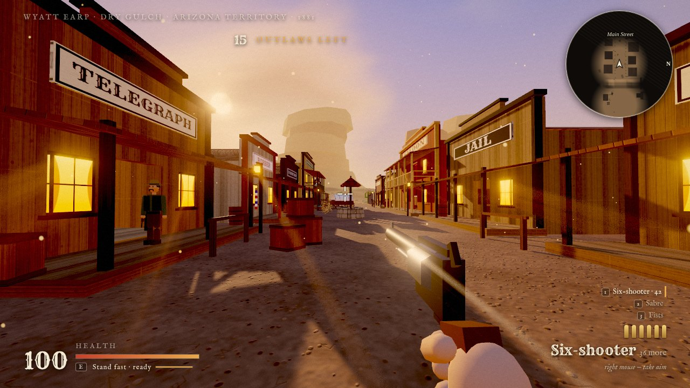 | 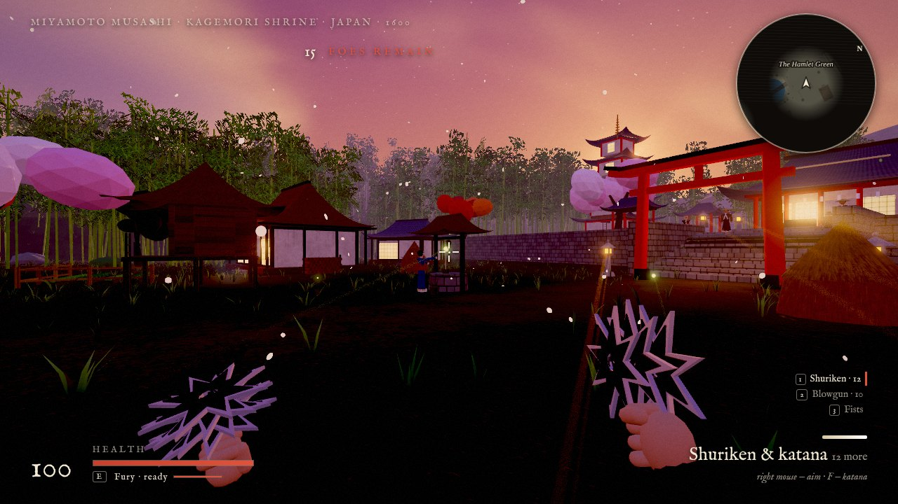 | 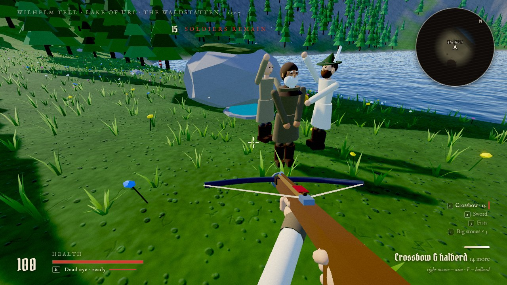 |
| **Chapter IV · Ithaca** | **Chapter V · Jarnvik** | **Chapter VI · Sainte-Aubine** |
| 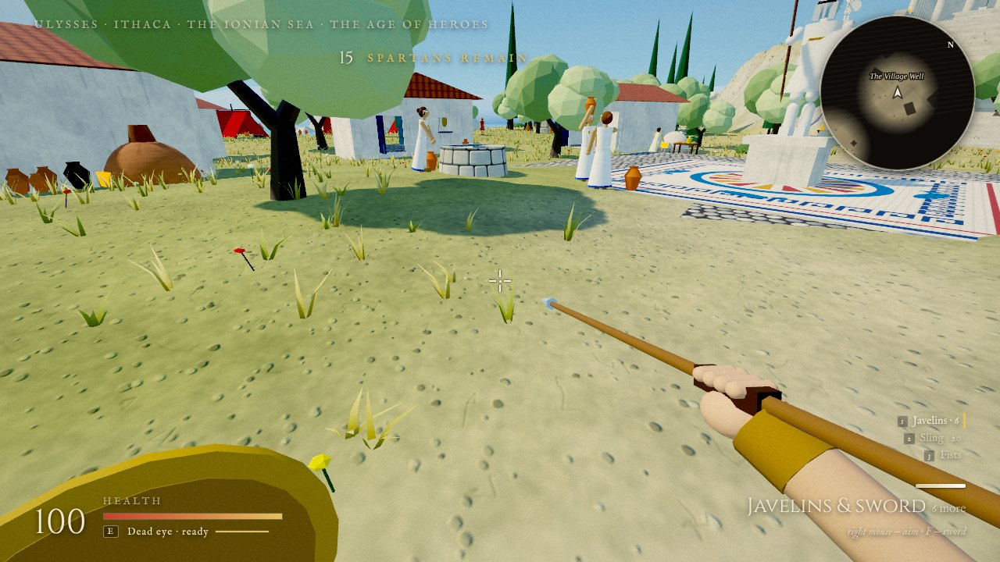 | 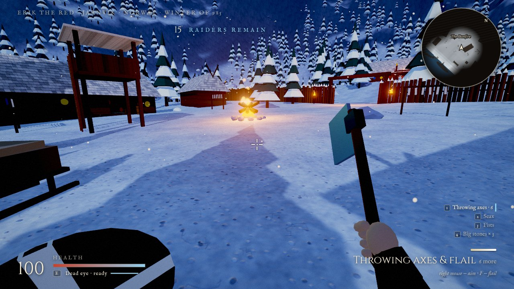 | 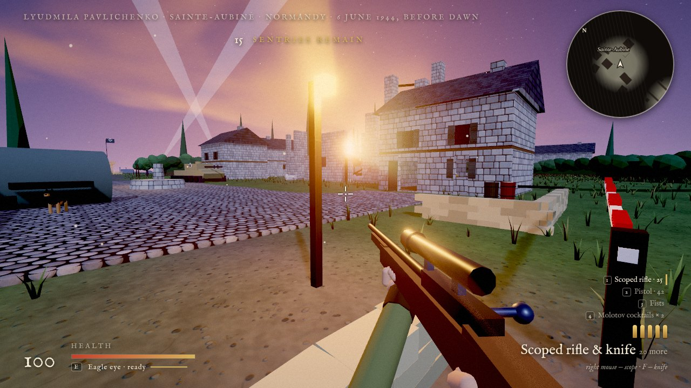 |
| **Chapter VII · Stalnogorsk** | **Chapter VIII · Che La** | **Chapter IX · Tenochtitlan** |
|  | 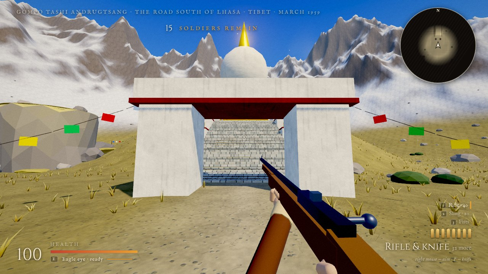 | 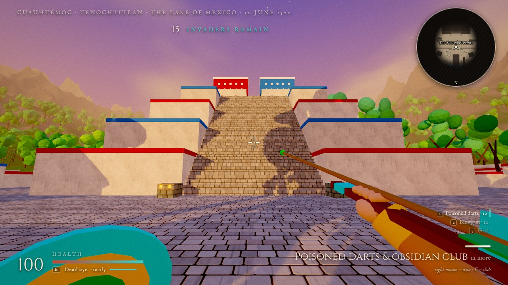 |

| Duel · choose your fighter | Duel · face to face |
| :---: | :---: |
| 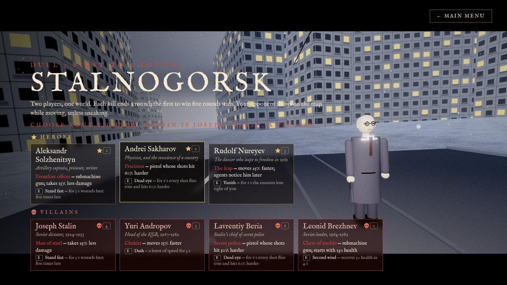 |  |

| Below Stalnogorsk · the metro | Inside the church of St Nicholas | The map, with the places found |
| :---: | :---: | :---: |
| 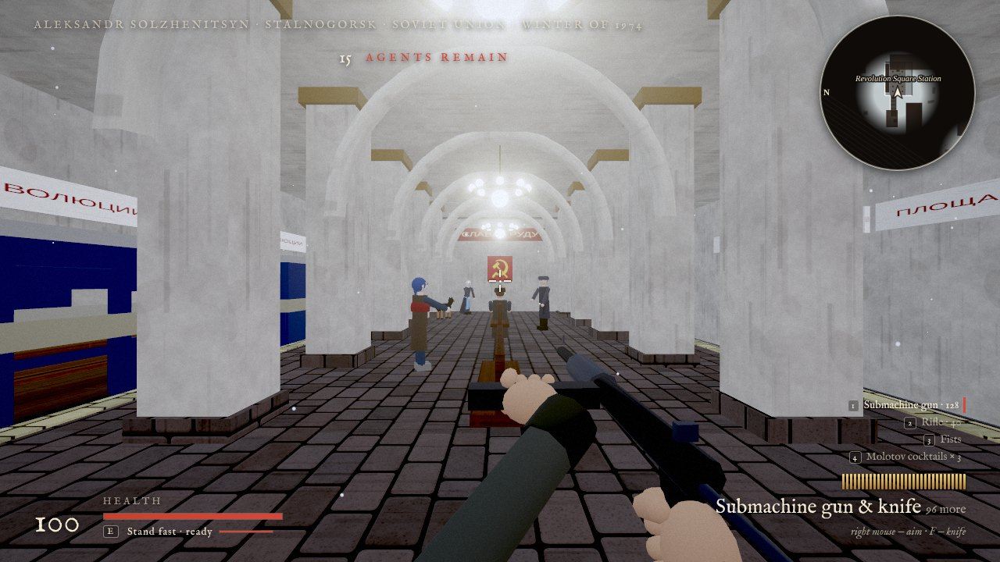 | 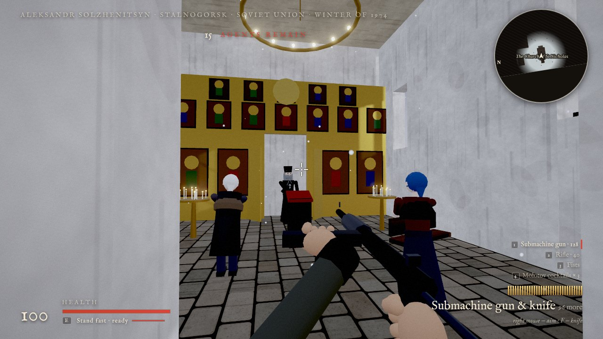 | 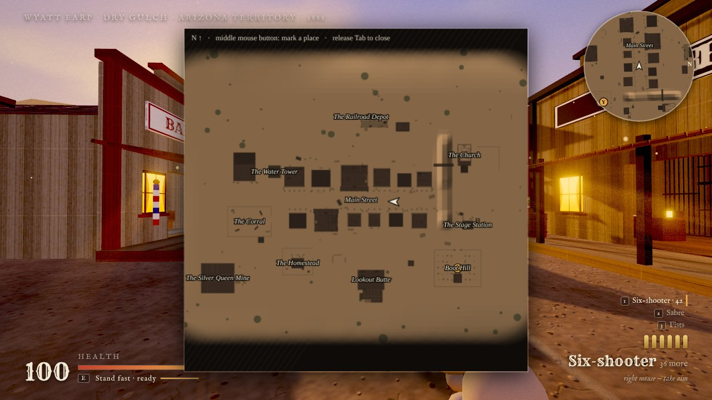 |

*Lone Hand* is a free-roaming 3D shooter in nine chapters, with every texture, model and sound generated by code. Each chapter starts with a choice of three heroes from history and legend, twenty-seven in all, among them Wyatt Earp, Miyamoto Musashi, Wilhelm Tell, Ulysses, Erik the Red, Lyudmila Pavlichenko, Andrei Sakharov, Gompo Tashi Andrugtsang and Cuauhtémoc, each with their own look and one strength. Most buildings can be entered and are furnished, four Viking longships can be boarded, a path leads behind the waterfall of Uri, and every chapter offers several ways to the enemy. About 130 people who take no part in the fight, half of them women, go about their day: a woman keeps the bar in Dry Gulch, three men swear the oath on the Rütli, Penelope weaves in Ithaca, Norse women hang cod on the racks, nuns turn the prayer wheels of Che La, market women sell in Tenochtitlan. You can crouch, climb 58 ladders onto roofs, towers, scaffolds and rocks, crawl through hedges and drains and under wagons, and walk up a butte by steps of rock, for an ambush or a sniper's nest. A chapter holds 5 to 30 enemies (45 on a large map), as you choose, and they think as cleverly as you choose: dull, medium or genius, from those who only fight back to those who hide, call each other, climb after you and throw bombs at where you hide. The map can be small, medium or large, with hamlets round a large one. Every hero sets out with two weapons and a special skill. Landmarks get their names on the map as you find them, enemies shout at you in their own languages, and in Stalnogorsk you can go down into the metro, up a stairwell to five floors of flats, and into an Orthodox church. Weapons can be taken from fallen enemies and changed with the mouse wheel, healing items and bombs kept in a bag, places marked on a map, fences, furniture, carts, crates and powder kegs shot to pieces; bystanders run for cover when shooting starts, and some of them, like some animals, fight back when hurt. Two to four players can play online, each in their own browser and with voice chat, through a small game server that connects them whatever their network: a duel, one against one or two against two, capture the flag, or together against the enemy, as a hero or as one of thirty villains. **[Play it in your browser](https://outlaws.kaiseregg.com/)**, or download the repository and open `Claude/index.html`. [Controls and technical notes](Claude/README.md) · [Changelog](Claude/CHANGELOG.md), version 2.5.0

## Game history

**1997 — Outlaws.** LucasArts released *Outlaws*, a first-person shooter set in the Old West, on an enhanced version of the engine it had built for *Dark Forces*. Retired marshal James Anderson hunts the gang that killed his wife and took his daughter. The game is remembered for its hand-drawn animated story scenes, for Clint Bajakian’s score in the manner of the Italian Westerns, and for making the player reload by hand. It is often credited as one of the first shooters with a sniper scope. [The game on Wikipedia](https://en.wikipedia.org/wiki/Outlaws_(1997_video_game)) · [Gameplay video](https://www.youtube.com/watch?v=9n4ghEkKV-Q)

**1998 — Handful of Missions.** LucasArts followed with a free add-on of further single-player missions and multiplayer maps.

**2025 — The remaster.** Nightdive Studios brought the game and its add-on back as *Outlaws + Handful of Missions: Remaster*, with higher-resolution art and support for current systems. [The remaster on Steam](https://store.steampowered.com/app/3366780/Outlaws_Handful_of_Missions_Remaster/)

**2026 — Lone Hand.** The frontiers are open 3D places to walk through: the main street of Dry Gulch at golden hour, a path of torii gates through a bamboo forest, and a valley on the Lake of Uri. The gunslinger carries a six-shooter, the samurai throwing stars and a katana, and the crossbowman of Uri a crossbow and a halberd. Two further chapters followed: a Greek island held by Spartans, fought with javelins and a short sword, and a Norwegian fjord under the northern lights, fought with throwing axes. A sixth is set in Normandy before dawn on 6 June 1944: three people who resisted the Nazi regime, with a scoped rifle, a Sten gun and a pistol, cross hedgerows and a guarded village to silence a coastal battery. Two more chapters and a rebuilt world followed: a grey Soviet city in the winter of 1974, held by the KGB, and the road south of Lhasa in March 1959, where the player clears the way for the Dalai Lama's escape. Many buildings can now be entered, among them the saloon, the jail and the bank of Dry Gulch; walls and bodies are solid, and enemies find their own way round walls and through doors. A Duel mode then set two players against each other online, with villains from Jesse James to the Cyclops to choose beside the heroes. A further round opened most buildings, moored four longships to board at Jarnvik, cut a path behind the waterfall of Uri, and put flute monks, geisha, golden Buddhas, the hammer and sickle and three more Greek villains into the world. The latest round added crouching, a climbable butte and knoll, roofs and hides reached by jumping, and dens with crawl-in doors. The church of Dry Gulch then opened its door, with a stair inside the tower up to the bell. Ladders then replaced the crates to jump on: face one and walk, and you climb; and the knoll of Uri became a natural boulder with a summit cross, reached by a ladder that leans against it. The hero screen then gained an Enemies list (10 to 30, or all of them), and the arrow keys now move exactly like W A S D. A ninth chapter followed: Tenochtitlan at sunset on 30 June 1520, with the Great Temple to climb, a causeway over the lake, jungle, a smoking volcano, Spanish horsemen and a cannon, and a poisoned dart-thrower. Then all nine worlds grew: back doors and upper floors, a railroad and a mine in Dry Gulch, rice paddies in Kagemori, the Rütli and a lake landing in Uri, a city of canals in place of the jungle of Tenochtitlan, holes to crawl through the hedgerows of Normandy; and people moved in who take no part in the fight, half of them women, each at their work. A chapter now holds thirty enemies at most. Later rounds made everything but stone breakable, from bottles to wooden walls, and gave the fists something to hit; let the bystanders take fright, talk to the player and fall; put a limit on every weapon's ammunition, with boxes to find; uncovered the map as it is explored, with places to mark; let the player take the weapons of fallen enemies and carry things in a bag; and opened games for two online: a duel in five rounds or seven minutes, capture the flag, and together against the enemy (version 1.9). Version 2.0 gave the enemies three levels of wits and ears to hear with, the maps three sizes with hamlets round the large one, every hero a second weapon and a special skill, new weapons (knife, sword, sabre, halberd, sling, blowgun, big stones, Molotov cocktails), and missiles to pick up again where they fell. Version 2.1 named the places of every chapter, shared the map and the marks between two players together, made roofs to stand on and stopped shots at what is drawn, took Stalnogorsk below ground into a metro station and up a stairwell of five floors, opened an Orthodox church with its priest, gave the enemies voices in their own languages, set the bystanders to work, and redrew the sky and the textures. Version 2.2 put a game server between the players, so that a game online connects from any network, and opened it to four players, two against two or all together. Version 2.3 let the animals be hurt and killed, set some of them and some bystanders against the player who hurts them, put every bystander to some occupation, and made the flight line of thrown weapons fine, and red on a target. Version 2.4 set a bamboo deer scarer knocking in the tea garden of Kagemori and a pilgrim going round a chorten of Che La by prostrations. Version 2.5 gave every chapter a place of its culture or its time: a Spanish mission, a Japanese castle, the Devil's Bridge, the contest of the bow, a thing field, a paratrooper hanging from a church tower, a kvas tanker, an iron chain bridge and Moctezuma's house of birds. [Explore the Claude edition](Claude/)


## Structure

```text
outlaws/
|-- Claude/    # the game, its source code, screenshots and technical README
|-- index.html # opens the game
`-- README.md
```
